# Excel VBA Second Brain

> [!important]
> **Mission Statement**: *From repetitive Excel tasks → automated, reliable, production-ready systems.*  
> A personal knowledge architecture for mastering Excel VBA, macros, automation engineering, reporting pipelines, UserForms, defensive debugging, and Office suite integration.

---

## 🧭 Navigation & Command Center Hub

<div class="vba-grid-4">

<div class="vba-card">
<div class="vba-card-header">📊 Core Dashboards</div>

- [[Learning Dashboard|📊 Learning Metrics]]
- [[Course Roadmap|🗺️ Full Roadmap]]
- [[Knowledge Map|🌐 Concept Map]]
- [[Progress Dashboard|📈 Progress Matrix]]
- [[14 - Questions & Insights/Interview Questions|💼 Interview Prep]]
</div>

<div class="vba-card">
<div class="vba-card-header">🧭 Knowledge MOCs</div>

- [[VBA MOC|🏛️ Core VBA Syntax]]
- [[Excel Automation MOC|📊 Excel Object Model]]
- [[Data Automation MOC|🔄 Data & In-Memory Arrays]]
- [[Reporting Automation MOC|📈 Reporting Pipelines]]
- [[Office Automation MOC|📬 Office Suite Automation]]
</div>

<div class="vba-card">
<div class="vba-card-header">📁 Production Projects</div>

- [[Projects Overview|📁 All Projects]]
- [[Project 01 - Table of Contents Generator/Requirements|📑 Project 01: Dynamic TOC]]
- [[Project 02 - Regional Sales Reporting Tool/Requirements|📊 Project 02: Regional ETL]]
- [[Project 03 - Invoice Generation Tool/Requirements|🧾 Project 03: Invoice Tool]]
- [[08 - Advanced VBA/Architecture & Best Practices/VBA for Data Analysts|📊 VBA for Data Analysts]]
</div>

<div class="vba-card">
<div class="vba-card-header">⚡ Reference & Cookbook</div>

- [[Cheat Sheets/VBA Syntax Cheat Sheet|⚡ Syntax Cheat Sheet]]
- [[Cheat Sheets/Excel Object Model Cheat Sheet|🏛️ Object Model Sheet]]
- [[Cheat Sheets/Debugging Cheat Sheet|🔍 Debugging Cheat Sheet]]
- [[Code Cookbook/Patterns/Last Used Row and Column|📖 Code Cookbook]]
- [[14 - Questions & Insights/Questions|❓ Active Recall Review]]
</div>

</div>

---

## 📈 Learning Velocity & Progress Tracker

```text
Course Completion [███░░░░░░░░░░░░░] 19% (33 / 174 Lectures Completed)
Time Invested     [███░░░░░░░░░░░░░] 4.3 / 22.5 Hours
```

<div class="vba-grid-3">

<div class="vba-card">
<div class="vba-card-header">🎯 Active Section</div>

[[Section 05 - Working with Variables|Section 05: Working with Variables]]  
*Focus*: Dim, Data Types, Option Explicit, Set Statement, Scope.
</div>

<div class="vba-card">
<div class="vba-card-header">⏭️ Next Target Lecture</div>

[[Lecture S05-01 - Overview Role of Assignment & Variables|Lecture S05-01: Role of Assignment & Variables]]  
*Key Pattern*: Value assignment vs Object Set statements.
</div>

<div class="vba-card">
<div class="vba-card-header">🏆 Next Major Milestone</div>

[[Project 01 - Table of Contents Generator/Requirements|Project 01: Dynamic TOC Generator]]  
*Section 09*: Hyperlinking worksheets & PERSONAL.XLSB.
</div>

</div>


---

## ⚡ Core Mental Model Flow

```mermaid
%%{init: {'theme': 'dark', 'themeVariables': { 'darkMode': true, 'fontFamily': 'Inter, sans-serif' }}}%%
flowchart LR
    A["⚙️ <b>VBA Syntax</b><br/><i>[[VBA Syntax]]</i>"]:::stepNode --> B["🏛️ <b>Object Model</b><br/><i>[[VBA Object Model|Object Model]]</i>"]:::stepNode
    B --> C["🎯 <b>Range & Cells</b><br/><i>[[Range]]</i>"]:::stepNode
    C --> D["📦 <b>Data & Types</b><br/><i>[[Variables & Data Types]]</i>"]:::stepNode
    D --> E["🔀 <b>Loops & Logic</b><br/><i>[[Conditional Logic Patterns|Control Flow]]</i>"]:::stepNode
    E --> F["⚡ <b>Arrays & Speed</b><br/><i>[[Arrays|Data & Speed]]</i>"]:::stepNode
    F --> G["🛡️ <b>Reliability</b><br/><i>[[Debugging|Debugging]]</i>"]:::finishNode

    classDef stepNode fill:#0c4a6e,stroke:#38bdf8,stroke-width:2px,color:#f0f9ff;
    classDef finishNode fill:#064e3b,stroke:#10b981,stroke-width:2px,color:#ecfdf5;
```



---

## 🔍 Active & Upcoming Lectures (Dataview Engine)

```dataview
TABLE 
  section_number AS "Sec",
  lecture_number AS "Lec #",
  status AS "Status",
  topics AS "Topics"
FROM "01 - Course/Lectures"
WHERE status = "in-progress" OR (section_number = 4 AND status != "completed")
SORT section_number ASC, lecture_number ASC
LIMIT 8
```

---

## 💡 Recent Architectural Notes & Breakthroughs

```dataview
TABLE 
  file.folder AS "Domain",
  status AS "Status",
  difficulty AS "Level"
FROM "02 - VBA Fundamentals" OR "03 - Excel Object Model" OR "06 - Debugging & Reliability"
WHERE file.name != "02 - VBA Fundamentals" AND file.name != "03 - Excel Object Model"
SORT file.mtime DESC
LIMIT 6
```

---

## 🛠️ Quick Learning Playgrounds
- 🧪 [[Playground Readme|Active Exploration Sandbox]]
- 🐛 [[06 - Debugging & Reliability/Troubleshooting/VBA Troubleshooting Matrix|VBA Troubleshooting Matrix]]
- 💡 [[14 - Questions & Insights/Things I Finally Understood|Things I Finally Understood]]
- ⚠️ [[14 - Questions & Insights/Mistakes|Common Pitfalls & The "VBA Hall of Shame"]]
