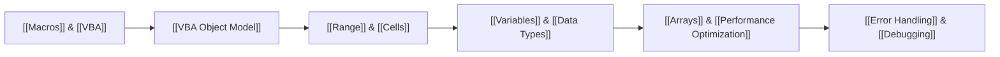

# Excel VBA Second Brain

> **From repetitive Excel tasks → automated systems.**  
> Personal knowledge base for mastering Excel VBA, macros, automation, reporting, UserForms, debugging, and Office integration.

---

## 🧭 Command Center & Navigation Hub

| Core Dashboards | Knowledge Maps & MOCs | Projects & Real-World | Reference & Practice |
| :--- | :--- | :--- | :--- |
| 📊 [[Learning Dashboard]] | 🧭 [[VBA MOC]] | 📁 [[Projects Overview]] | ⚡ [[Cheat Sheets/VBA Syntax Cheat Sheet|Syntax Cheat Sheet]] |
| 🗺️ [[Course Roadmap]] | 🏛️ [[Excel Automation MOC]] | 📑 [[Project 01 - Table of Contents Generator/Requirements|Project 01: TOC Generator]] | 🏛️ [[Cheat Sheets/Excel Object Model Cheat Sheet|Object Model Sheet]] |
| 🌐 [[Knowledge Map]] | 🔄 [[Data Automation MOC]] | 📊 [[Project 02 - Regional Sales Reporting Tool/Requirements|Project 02: Regional Reporting]] | 🔍 [[Cheat Sheets/Debugging Cheat Sheet|Debugging Cheat Sheet]] |
| 📈 [[Progress Dashboard]] | 📈 [[Reporting Automation MOC]] | 🧾 [[Project 03 - Invoice Generation Tool/Requirements|Project 03: Invoice Tool]] | 📖 [[Code Cookbook/Patterns/Last Used Row and Column|Code Cookbook]] |
| 💼 [[14 - Questions & Insights/Interview Questions|Interview Prep]] | 📬 [[Office Automation MOC]] | 📊 [[08 - Advanced VBA/Architecture & Best Practices/VBA for Data Analysts|VBA for Data Analysts]] | ❓ [[14 - Questions & Insights/Questions|Active Recall Review]] |

---

## 📊 Course Completion Progress

```text
Course Progress [████░░░░░░░░░░░░░░░░] 21% (37 / 174 Lectures Completed)
Time Invested   [████░░░░░░░░░░░░░░░░] 4.7 / 22.5 Hours
```

- **Current Active Section**: [[Section 04 - Referencing Ranges, Worksheets & Workbooks|Section 04: Referencing Ranges, Worksheets & Workbooks]]
- **Current Milestone Target**: [[Project 01 - Table of Contents Generator/Requirements|Project 01: Table of Contents Generator]] (Section 09)
- **Next Upcoming Lecture**: [[Lecture S04-05 - Copying & resizing a variably sized range|Lecture S04-05: Copying & resizing a variably sized range]]

---

## ⚡ Quick Access: Essential Concepts



---

## 🔍 Incomplete / Active Lectures (Dataview & Fallback)

```dataview
TABLE section AS "Section", lecture_number AS "Lecture #", topics AS "Topics"
FROM "01 - Course/Lectures"
WHERE status = "in-progress" OR (section_number = 4 AND status != "completed")
SORT section_number ASC, lecture_number ASC
LIMIT 6
```

*(If Dataview is disabled, view full active progress in the [[Course Roadmap]].)*

---

## 💡 Recent Breakthroughs & Lessons
- [[14 - Questions & Insights/Things I Finally Understood|Things I Finally Understood]]
- [[14 - Questions & Insights/Mistakes|Common VBA Pitfalls & Mistakes]]
- [[06 - Debugging & Reliability/Troubleshooting/VBA Troubleshooting Matrix|VBA Troubleshooting Matrix]]
