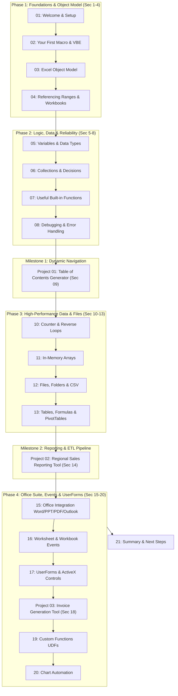

# Master Excel VBA & Macros — Course Overview

> [!important]
> **Instructor**: Leila Gharani (Microsoft MVP)  
> **Course Scope**: 22.5 hours of on-demand video across 21 structured sections and 174 comprehensive lectures.  
> **Target Outcome**: Transform manual spreadsheet workflows into professional, self-healing Excel automation systems.

---

## 🧭 Course Architecture & Milestones

The curriculum balances fundamental programming theory with three enterprise-grade automation projects:

---

## 📊 Major Milestones & Real-World Projects

1. **[[Project 01 - Table of Contents Generator]] (Section 09)**:
   - Dynamic scanning of all visible/hidden sheets
   - Automated two-way hyperlinks between TOC and sheets
   - Personal Macro Workbook (`PERSONAL.XLSB`) global deployment
2. **[[Project 02 - Regional Sales Reporting Tool]] (Section 14)**:
   - Multi-file batch import and consolidation via `MultiSelect`
   - Template-based reporting with automated PivotTables
   - Clean CSV export with semicolon delimiters for ERP systems
   - Automated task activity tracking and password-protected sheet protection
3. **[[Project 03 - Invoice Generation Tool]] (Section 18)**:
   - Interactive UserForm with searchable multi-column ListBox
   - Master data CRUD operations (Customer & Product datasets)
   - Automated PDF invoice generation and direct Outlook email dispatch

---

## 🔗 Quick Navigation
- **[[Course Roadmap]]**: Full visual checklist of all 21 sections and 174 lectures.
- **[[Learning Dashboard]]**: Tracking current progress and study metrics.
- **[[VBA MOC]]**: High-level conceptual navigation.
- **[[Projects Overview]]**: Architectural deep-dive for all three major course projects.
