# ByVal vs. ByRef (Parameter Passing Architecture)

> [!important]
> **Core Architectural Principle**: When passing variables into a `Sub` or `Function`:
> - **`ByRef` (By Reference)**: Passes the **direct memory pointer** (address) of the original variable. Any modification inside the procedure directly alters the caller's original variable!
> - **`ByVal` (By Value)**: Passes a **cloned copy** of the data in a new memory address. The called procedure cannot alter the caller's original variable.
>
> ⚠️ **CRITICAL VBA GOTCHA**: In VBA, if you omit the keyword, parameters default to **`ByRef`**!

---

## 🧠 The Visual Mental Model: Shared Document vs. Photocopied Paper

<div class="vba-grid-2">

<div class="vba-card">
<div class="vba-card-header">🔗 ByRef (By Reference)</div>

**Live Google Doc / Pointer**  
You give someone the link to the live original document. If they cross out text, edit numbers, or delete a table, **your original document is permanently modified**.
</div>

<div class="vba-card">
<div class="vba-card-header">📋 ByVal (By Value)</div>

**Photocopied Printout**  
You make a photocopy and hand it to them. They can write notes, scribble with highlighter, or rip it up; **your original document in the drawer is 100% untouched**.
</div>

</div>

---

## 🔬 Memory Architecture Diagram

```mermaid
flowchart TD
    subgraph CallerRAM["Caller Memory Frame (Main Sub)"]
        OrigVal["Variable: totalSales<br/>Address: <b>0x00FF4A</b><br/>Value: <b>1,000</b>"]
    end

    subgraph ByRefScenario["ByRef Execution: Direct Pointer"]
        direction TB
        Ptr["Param: x<br/>Address: Points to 0x00FF4A"]
        Action1["x = x * 1.20"]
        Result1["OrigVal updated directly in 0x00FF4A!<br/>New totalSales = <b>1,200</b>"]
        Ptr --> Action1 --> Result1
    end

    subgraph ByValScenario["ByVal Execution: Cloned Copy"]
        direction TB
        Clone["Param: x<br/>Address: <b>0x00A110</b> (New)<br/>Cloned Value: 1,000"]
        Action2["x = x * 1.20"]
        Result2["Only 0x00A110 changes to 1,200.<br/>Original 0x00FF4A remains <b>1,000</b>!"]
        Clone --> Action2 --> Result2
    end

    OrigVal -.->|ByRef passes address| Ptr
    OrigVal -.->|ByVal allocates new copy| Clone

    style CallerRAM fill:#181a24,stroke:#38bdf8,stroke-width:2px
    style ByRefScenario fill:#12141c,stroke:#ef4444,stroke-width:2px
    style ByValScenario fill:#12141c,stroke:#10b981,stroke-width:2px
```



---

## ⚖️ Detailed Technical Comparison

| Dimension | `ByRef` (Default) | `ByVal` (Explicit) |
| :--- | :--- | :--- |
| **VBA Keyword** | `ByRef` (or omitted) | `ByVal` (must write explicitly) |
| **Memory Allocation** | Zero new memory allocated (uses existing pointer) | Allocates new memory bytes on Stack for the clone |
| **Caller Variable Protection** | ❌ None (vulnerable to mutation) | ✅ Protected (immutable from callee) |
| **Default in VBA?** | ⚠️ **Yes (Implicit default)** | ❌ No |
| **Primary Use Case** | When you intentionally want to return multiple values or mutate an array/object | Pure calculations, input data sanitization, defensive functions |
| **Performance Impact** | Faster for massive user-defined types (no copy overhead) | Micro-cost to clone primitive bytes (negligible for Long, Double, String) |

---

## 💻 Code Demonstrations

### 1. The Accidental Side-Effect Bug (`ByRef`)
```vba
Option Explicit

Sub MainCaller()
    Dim invoiceTotal As Double
    invoiceTotal = 500
    
    ' Call procedure that has no ByVal keyword
    ApplyDiscount invoiceTotal
    
    ' BUG! invoiceTotal is now 450! The caller had no idea it was modified!
    Debug.Print "Invoice Total after discount: " & invoiceTotal
End Sub

' Because ByRef is the default, 'amount' points directly to 'invoiceTotal'
Sub ApplyDiscount(ByRef amount As Double)
    amount = amount * 0.9  ' Modifies the caller's variable!
End Sub
```

---

### 2. The Defensive Pattern (`ByVal`)
```vba
Option Explicit

Sub MainCallerProtected()
    Dim invoiceTotal As Double
    invoiceTotal = 500
    
    Dim finalAmount As Double
    finalAmount = CalculateDiscount(invoiceTotal)
    
    ' invoiceTotal is STILL 500! Safe and predictable.
    Debug.Print "Original: " & invoiceTotal   ' 500
    Debug.Print "Calculated: " & finalAmount ' 450
End Sub

Function CalculateDiscount(ByVal amount As Double) As Double
    amount = amount * 0.9                   ' Safe: only affects internal copy
    CalculateDiscount = amount
End Function
```

---

## 🚀 The Special Case: Objects (`Worksheet`, `Range`, `Workbook`)

What happens when you pass an **Object** using `ByVal`?

```mermaid
flowchart LR
    CallerObj["Caller: Set ws = Sheet1"] -->|ByVal wsTarget As Worksheet| Worker["Worker Sub"]
    Worker -->|Can modify contents!| Cell["wsTarget.Range('A1').Value = 99 (UPDATED!)"]
    Worker -->|Cannot change caller reference!| Reassign["Set wsTarget = Sheet2 (IGNORED by caller!)"]

    style CallerObj fill:#181a24,stroke:#38bdf8
    style Cell fill:#12141c,stroke:#10b981
    style Reassign fill:#12141c,stroke:#ef4444
```



> [!warning]
> **Key Nuance with Objects**:
> When you pass an Object `ByVal`, you pass a **copy of the pointer to the object**.
> - You **CAN** modify properties of the underlying Excel sheet or range (`ws.Cells(1,1).Value = "Done"`).
> - You **CANNOT** reassign the caller's object pointer to a completely different object (`Set ws = Sheets("Other")` will not change the caller's `ws` variable).

---

## 🛡️ Production Best Practices & Rules of Thumb

> [!tip]
> 1. **Default to `ByVal` for Functions**: Any function computing a result should declare all numeric and string inputs as `ByVal`.
> 2. **Never rely on the implicit default**: Always write either `ByVal` or `ByRef` explicitly in every procedure parameter signature. This leaves zero ambiguity for the next developer reading your code.
> 3. **Use `ByRef` intentionally**: Use `ByRef` only when you deliberately want to return 2 or more modified variables from a single subroutine (e.g., `Sub ParseFullName(ByVal fullName As String, ByRef firstName As String, ByRef lastName As String)`).

---

## 🧪 Active Recall Quiz

> [!question]- 1. What will be printed by the following code? *(Click to expand)*
> ```vba
> Sub Test()
>     Dim n As Long
>     n = 10
>     DoubleIt n
>     Debug.Print n
> End Sub
> 
> Sub DoubleIt(val As Long)
>     val = val * 2
> End Sub
> ```
> **Answer**: `20`  
> *Explanation*: Since no keyword (`ByVal` or `ByRef`) was specified in `Sub DoubleIt(val As Long)`, VBA defaults to **`ByRef`**! `val` points to `n`, so `n` is doubled directly in memory.

---

## 🔗 Connected Notes
- **Subroutines & Functions**: [[Procedures & Functions]]
- **Scope & Lifetime**: [[Scope]]
- **Variables & Memory**: [[Variables]], [[Data Types]]
