# Procedures & Functions (`Sub` vs. `Function`)

> [!important]
> **Summary Statement**:
> - A **`Sub` (Subroutine)** executes a sequence of statements to perform actions, alter application state, and manipulate worksheets. It **does not return a value** directly to an assignment expression.
> - A **`Function`** executes statements to calculate and **return a value** to the caller. When placed in a standard module, it can also be called directly inside Excel worksheet cells as a **User-Defined Function (UDF)**.

---

## ⚖️ Architectural Comparison: `Sub` vs. `Function`

```mermaid
%%{init: {'theme': 'dark', 'themeVariables': { 'darkMode': true, 'fontFamily': 'Inter, sans-serif' }}}%%
flowchart TD
    subgraph SubFlow["⚙️ Sub Procedure: Orchestration & Action Engine"]
        S_In["⚡ <b>Caller Invokes Sub</b><br/><code>Call FormatMonthlySheet(ws)</code>"]:::subInput
        S_Do["🎯 <b>Mutates Application State</b><br/>Formats Borders, Inserts Columns, Generates Workbooks"]:::subAction
        S_End(["🏁 <b>Exits Routine</b><br/><i>Returns no value to caller</i>"]):::subEnd
        S_In --> S_Do --> S_End
    end

    subgraph FuncFlow["🧮 Function Procedure: Computation Engine"]
        F_In["📥 <b>Caller Supplies Arguments</b><br/><code>net = CalcNet(revenue, cost)</code>"]:::funcInput
        F_Calc["🧠 <b>Computes in Memory (RAM)</b><br/>Pure mathematical / string transformation"]:::funcAction
        F_Ret["📤 <b>Assigns to Function Name:</b><br/><code>CalcNet = revenue - cost</code>"]:::funcReturn
        F_Out(["🎯 <b>Yields Value to Expression / Cell</b>"]):::funcEnd
        F_In --> F_Calc --> F_Ret --> F_Out
    end

    classDef subInput fill:#0c4a6e,stroke:#38bdf8,stroke-width:2px,color:#f0f9ff;
    classDef subAction fill:#1e293b,stroke:#0284c7,stroke-width:2px,color:#f8fafc;
    classDef subEnd fill:#0f172a,stroke:#64748b,stroke-width:1.5px,color:#94a3b8;
    classDef funcInput fill:#1e1b4b,stroke:#8b5cf6,stroke-width:2px,color:#f8fafc;
    classDef funcAction fill:#1e293b,stroke:#a855f7,stroke-width:2px,color:#f8fafc;
    classDef funcReturn fill:#064e3b,stroke:#10b981,stroke-width:2px,color:#ecfdf5;
    classDef funcEnd fill:#092e20,stroke:#34d399,stroke-width:2px,color:#d1fae5;
```



| Feature | `Sub` Procedure | `Function` Procedure |
| :--- | :--- | :--- |
| **Returns a Value?** | ❌ No | ✅ Yes (assigned to the function's name) |
| **Used in Excel Cell Formulas?** | ❌ No | ✅ Yes (as a User-Defined Function / UDF) |
| **Can Modify Spreadsheet Layout?** | ✅ Yes (format cells, insert rows, delete sheets) | ⚠️ **Only when called by a Sub**; when called from an Excel cell formula, it is **sandboxed** and can ONLY return a value! |
| **Trigger Mechanism** | Button, Shape, Ribbon, Hotkey, VBA call, Event | Evaluated by formula calculation or called within VBA |
| **Primary Architectural Role** | **Orchestration & Workflow Actions** | **Computation, Transformation, Data Extraction** |

---

## 💻 Syntax & Code Patterns

### 1. `Sub` Procedure (Action-Oriented)
```vba
Option Explicit

Public Sub FormatReportHeader(ByVal ws As Worksheet, ByVal title As String)
    With ws.Range("A1:G1")
        .Merge
        .Value = title
        .Font.Bold = True
        .Font.Size = 14
        .Font.Color = RGB(255, 255, 255)
        .Interior.Color = RGB(16, 124, 65) ' Microsoft Excel Green
        .HorizontalAlignment = xlCenter
        .VerticalAlignment = xlCenter
    End With
    ws.Rows(1).RowHeight = 35
End Sub
```

---

### 2. `Function` Procedure (Computation & Return)
```vba
Option Explicit

Public Function CalculateTax(ByVal subtotal As Double, _
                             Optional ByVal taxRate As Double = 0.0825) As Double
    If subtotal <= 0 Then
        CalculateTax = 0#
        Exit Function
    End If
    
    ' Assign the calculated value to the Function name itself to return it!
    CalculateTax = Round(subtotal * taxRate, 2)
End Function
```

---

## 🛡️ Parameter Passing Architecture: `ByVal` vs. `ByRef`

In VBA, parameters default to **`ByRef`** if you do not specify otherwise.

```vba
' RISKY: amount can be modified by the procedure, mutating the caller's variable!
Sub BadPractice(amount As Double)

' SAFE & DEFENSIVE: passes an isolated clone of the value
Sub GoodPractice(ByVal amount As Double)
```

> [!tip]
> For a full visual breakdown of memory pointers and stack frames, see [[ByVal vs ByRef]].

---

## ⚙️ Advanced Parameter Features

### 1. `Optional` Parameters with Default Values
You can make arguments optional and provide sensible defaults:
```vba
Function ExportReport(ByVal reportName As String, _
                      Optional ByVal fileFormat As String = "PDF", _
                      Optional ByVal openAfterSave As Boolean = False) As Boolean
    ' Use IsMissing() only for Variant types; for typed params, check against default!
    Debug.Print "Exporting " & reportName & " as " & fileFormat
    ExportReport = True
End Function
```

### 2. `ParamArray` (Variable-Length Arguments)
Accept an arbitrary number of inputs (similar to Excel's `SUM(val1, val2, ...)`):
```vba
Function CalculateTotalSum(ParamArray values() As Variant) As Double
    Dim total As Double
    Dim i As Long
    
    For i = LBound(values) To UBound(values)
        If IsNumeric(values(i)) Then
            total = total + values(i)
        End If
    Next i
    
    CalculateTotalSum = total
End Function
```

---

## ⚠️ The UDF Worksheet Sandbox Rule (Crucial Excel Boundary)

When a VBA `Function` is invoked from a worksheet cell (e.g. `=CalculateTax(A2)`), Excel places the function in a **strict read-only execution sandbox**:

<div class="vba-grid-2">

<div class="vba-card">
<div class="vba-card-header">✅ What a UDF CAN Do in a Cell</div>

- Read values passed into its arguments.
- Read values from other cells via `Range("B5").Value`.
- Perform mathematical, statistical, or string operations in RAM.
- Return a primitive value (Number, Text, Date, Boolean) or an Array of values.
</div>

<div class="vba-card">
<div class="vba-card-header">❌ What a UDF CANNOT Do in a Cell</div>

- Change cell background colors (`.Interior.Color`).
- Modify font size, bolding, or borders.
- Insert, delete, or rename worksheets.
- Write to another cell (`Range("C1").Value = "X"` will silently fail or error!).
- Open or save workbooks.
</div>

</div>

> [!danger]
> Attempting to alter worksheet state inside a UDF called from a formula will cause Excel to either return a `#VALUE!` error or silently ignore the formatting/write statements.

---

## 🧪 Active Recall Quiz

> [!question]- How does a VBA Function return its result to the calling code? *(Click to expand)*
> **Answer**: By assigning the computed value to the **name of the function itself** before exiting:
> ```vba
> MyFunction = computedResult
> ```

> [!question]- Why will `Range("A10").Interior.Color = vbYellow` fail when placed inside a Function called as a formula `=MyFunction(B1)`? *(Click to expand)*
> **Answer**: Worksheet UDFs operate inside a sandboxed calculation engine. They are restricted to returning calculated values and are strictly prohibited from mutating worksheet layout, structure, or formatting.

---

## 🔗 Connected Notes
- **Parameter Passing**: [[ByVal vs ByRef]]
- **Scope & Lifetime**: [[Scope]]
- **Persistent Local State**: [[Static Variables]]
- **Worksheet Formulas**: [[Custom VBA Functions]]
- **Error Handling**: [[06 - Debugging & Reliability/Error Handling/Error Handling]]
