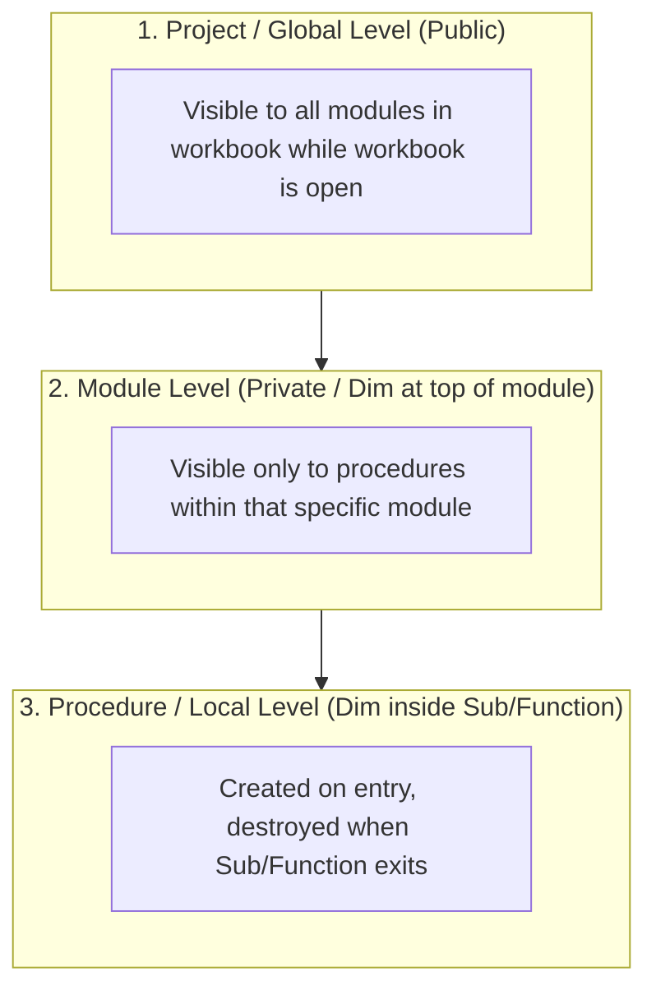

# Scope (Variable & Procedure Visibility)

> [!important]
> **Summary Statement**: Scope determines where in a codebase a variable, constant, or procedure can be seen, referenced, and modified, as well as its lifetime in memory.

---

## 📊 The 3 Scope Levels in VBA

| Scope Level | Declaration Syntax | Lifetime | Visibility |
| :--- | :--- | :--- | :--- |
| **Procedure (Local)** | `Dim x As Long` inside Sub/Function | During procedure execution | Only within the enclosing procedure |
| **Module (Private)** | `Private x As Long` or `Dim x As Long` at top declarations | While workbook remains open | All procedures in that module |
| **Global (Public)** | `Public x As Long` at top of standard module | While workbook remains open | Any procedure in any module |

---

## ⚠️ Best Practice Rule
> [!tip]
> **Default to the narrowest possible scope (Local)**. Only elevate to Module or Public scope when data genuinely needs to be shared across multiple procedures or UserForm events. Global variables increase coupling and make debugging difficult.

---

## 🔗 Connected Notes
- **Procedure Types**: [[Procedures & Functions]]
- **Variables**: [[Variables]]
