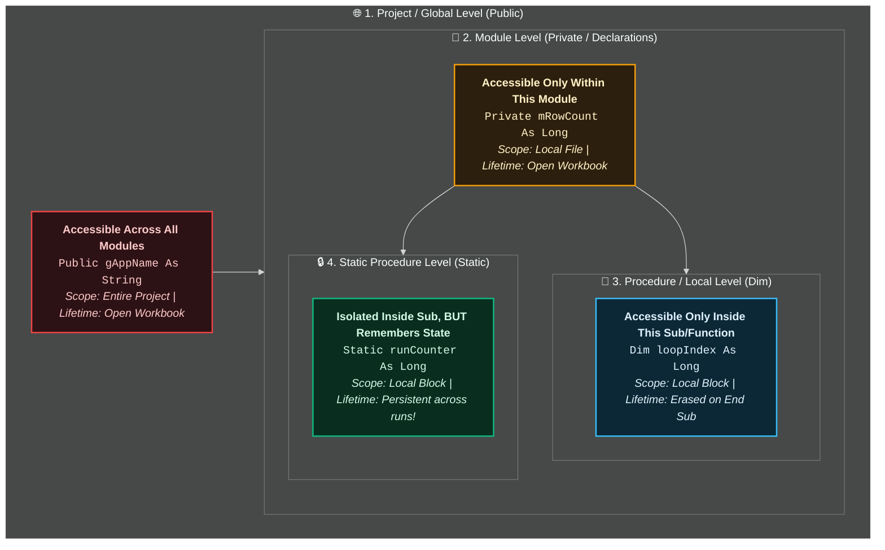
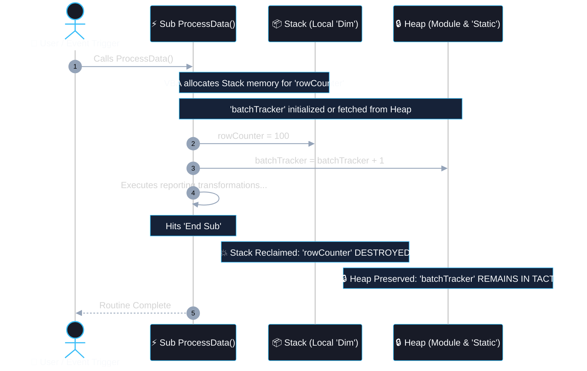
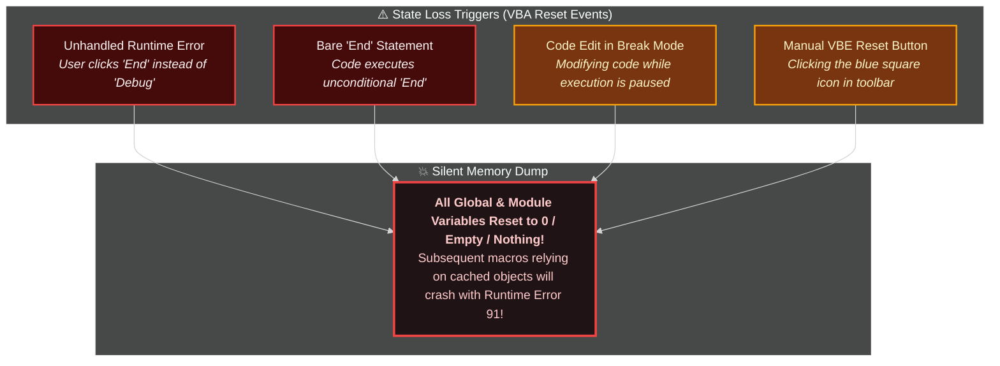

# Scope & Lifetime (Variable & Procedure Visibility)

> [!important]
> **Core Architectural Principle**: **Scope** determines *where* an identifier (variable, constant, procedure) can be seen and referenced in code. **Lifetime** determines *how long* that variable remains allocated in RAM before being destroyed.
> 
> *Golden Rule of Defensive Programming*: Always declare variables with the **narrowest possible scope** (Local Procedure). Only elevate to Module or Global scope when shared state is structurally unavoidable.

---

## 🧭 Visual Mental Model: The Security Clearance Hierarchy

Think of VBA Scope like security clearances inside a corporate enterprise:



---

## 📊 Comprehensive Scope & Lifetime Matrix

| Scope Level | Declaration Syntax | Where to Declare | Visibility (Who Can Read/Write?) | Lifetime in Memory | Risk of Side Effects |
| :--- | :--- | :--- | :--- | :--- | :---: |
| **Local (Procedure)** | `Dim x As Long` | Inside a `Sub` or `Function` | Only inside that specific procedure | Created on entry; **wiped out** on `End Sub` | 🟢 **Zero** (Safe) |
| **Static (Procedure)** | `Static x As Long` | Inside a `Sub` or `Function` | Only inside that specific procedure | Retains value across calls until workbook closes or VBA resets | 🟢 **Very Low** |
| **Private (Module)** | `Private x As Long` or `Dim x As Long` | Top of Module (before any `Sub`) | All procedures within *that specific module* | Entire session while Excel workbook remains open | 🟡 **Moderate** |
| **Public (Project/Global)** | `Public x As Long` | Top of a **Standard Module** | Every module, sheet, userform, and class in workbook | Entire session while Excel workbook remains open | 🔴 **High** (Fragile) |

---

## ⏱️ Memory Lifetime: The Execution Timeline

Variables do not just exist in space; they exist in **time**. Understanding when memory is allocated and released is essential for writing bug-free reporting engines:



---

## 🔍 Deep-Dive: The 4 Scope Levels with Code

### 1. Local Scope (`Dim` inside Procedure)
Variables exist only while the procedure is running. Once the code hits `End Sub`, VBA reclaims the memory.
```vba
Option Explicit

Sub CalculateTax()
    Dim taxRate As Double    ' Local variable
    Dim subtotal As Double   ' Local variable
    
    taxRate = 0.0825
    subtotal = Range("D15").Value
    Range("E15").Value = subtotal * (1 + taxRate)
    ' Once End Sub is reached, taxRate and subtotal cease to exist!
End Sub

Sub AnotherProcedure()
    ' Error! taxRate is not defined in this scope:
    ' Debug.Print taxRate
End Sub
```

---

### 2. Static Variables: The Local Variable with Infinite Memory
What if you need a procedure to remember how many times it was clicked, or retain a cached value, but you **don't** want other procedures accidentally messing with it?
Use `Static` instead of `Dim`!

```vba
Option Explicit

Sub LogEventCounter()
    ' Local visibility (only visible here), but survives between macro calls!
    Static executionCount As Long
    
    executionCount = executionCount + 1
    Debug.Print "Macro has been executed: " & executionCount & " time(s)."
End Sub
```
> [!tip]
> **Why `Static` is Superior to Module-Level Variables**: It keeps the variable **encapsulated**. No other procedure in your 5,000-line codebase can tamper with `executionCount`.

---

### 3. Module-Level Scope (`Private` / `Dim` at Module Top)
Declared in the **Declarations section** at the very top of a module (before the first `Sub` or `Function`). Shared across all macros in that single file.

```vba
Option Explicit

' =========================================================================
' DECLARATIONS SECTION (Top of Module1)
' =========================================================================
Private mTargetSheet As Worksheet
Private mRowCount As Long

Sub InitializeReport()
    Set mTargetSheet = ThisWorkbook.Sheets("Monthly_Data")
    mRowCount = mTargetSheet.Cells(mTargetSheet.Rows.Count, "A").End(xlUp).Row
    Debug.Print "Initialized for: " & mTargetSheet.Name & " (" & mRowCount & " rows)"
End Sub

Sub FilterActiveRecords()
    ' Both mTargetSheet and mRowCount are fully accessible here!
    If mTargetSheet Is Nothing Then
        MsgBox "Please run InitializeReport first!", vbCritical
        Exit Sub
    End If
    mTargetSheet.Range("A1:G" & mRowCount).AutoFilter Field:=3, Criteria1:="Active"
End Sub
```

> [!important]
> **Naming Convention Tip**: Prefix module-level variables with `m` (e.g., `mTargetSheet`, `mRowCount`) or `s_` for static. This makes it instantly obvious whether a variable is local or module-scoped when reading a long procedure!

---

### 4. Project / Global Scope (`Public` in Standard Module)
Declared with `Public` at the top of a **Standard Module** (e.g., `Module1`). Can be accessed and altered by any procedure in the entire Excel file.

```vba
' In Module1 (Declarations section):
Public gCurrentUser As String
Public gEnvironment As String

Sub AppStartup()
    gCurrentUser = Environ("USERNAME")
    gEnvironment = "PROD"
End Sub
```

---

## ⚡ Standard Modules vs. Object Modules: The Hidden Trap!

A major point of confusion for Excel developers is declaring `Public` variables inside different module types:

<div class="vba-grid-2">

<div class="vba-card" style="border-top: 3px solid #38bdf8;">
<div class="vba-card-header" style="color: #38bdf8;">📁 Standard Modules (Module1, ModUtils)</div>

```vba
' In Module1 (Declarations section):
Public gReportDate As Date
```

- **Behavior**: True global variable.
- **Access Pattern**: Visible everywhere by simple name `gReportDate`.
- **Primary Use**: Application configuration and shared constants.
</div>

<div class="vba-card" style="border-top: 3px solid #a855f7;">
<div class="vba-card-header" style="color: #a855f7;">📑 Object Modules (Sheet1, ThisWorkbook, UserForm1)</div>

```vba
' In Sheet1 (Declarations section):
Public customerCount As Long
```

- **Behavior**: Becomes a **Property of the Object**!
- **Access Pattern**: Must be qualified via the object: `Sheet1.customerCount`.
- **Primary Use**: Encapsulated state tied to a specific UI surface or worksheet.
</div>

</div>

> [!warning]
> **Crucial Difference**:
> - `Public x As Long` in a **Standard Module** (`Module1`): Accessible globally by just typing `x`.
> - `Public x As Long` in a **Sheet or UserForm Module** (`Sheet1`, `UserForm1`): It becomes a **property of that object**. To read it from another module, you must explicitly qualify it: `Sheet1.x`.

---

## 🎭 Variable Shadowing (Precedence Conflict)

What happens if you have a Global variable named `counter` and a Local variable also named `counter`?

```vba
Option Explicit

Public counter As Long   ' Global / Project Scope

Sub ShadowingExample()
    Dim counter As Long  ' Local Scope (SHADOWS the global variable!)
    
    counter = 50
    Debug.Print "Inside Sub: " & counter      ' Prints 50 (Local wins!)
End Sub

Sub CheckGlobal()
    Debug.Print "In Global: " & counter        ' Prints 0 (Global was never touched!)
End Sub
```

> [!danger]
> **The Shadowing Bug**: VBA will always use the **innermost** (most specific) variable definition. Shadowing leads to phantom bugs where you think you modified a global or module setting, but only altered a local variable with the identical name!

---

## 💥 The "VBA State Loss" Catastrophe (Why Globals Are Dangerous)

In enterprise data pipelines, relying heavily on `Public` variables is a known architectural anti-pattern. **Why? Because VBA can silently wipe all memory variables at any time!**



> [!caution]
> **Defensive Architecture**:
> If your macros depend on `Public gWorkbook As Workbook` and an unhandled error resets VBA, all subsequent macros will crash with:
> `Run-time error 91: Object variable or With block variable not set`.
> 
> **How to Protect Your Pipelines**:
> 1. Pass objects explicitly into procedures via arguments (`ByRef` / `ByVal`).
> 2. Use a "Self-Healing" getter function:
>    ```vba
>    Function GetMasterSheet() As Worksheet
>        Static ws As Worksheet
>        If ws Is Nothing Then
>            Set ws = ThisWorkbook.Sheets("Master")
>        End If
>        Set GetMasterSheet = ws
>    End Function
>    ```

---

## 🧪 Self-Assessment & Active Recall Challenge

> [!question]- 1. What will this code print to the Immediate Window? *(Click to expand)*
> ```vba
> Sub TestScope()
>     Dim i As Long
>     For i = 1 To 3
>         IncrementMe
>     Next i
> End Sub
> 
> Sub IncrementMe()
>     Static counter As Long
>     counter = counter + 10
>     Debug.Print counter
> End Sub
> ```
> **Answer**:
> ```text
> 10
> 20
> 30
> ```
> *Explanation*: Because `counter` is declared with `Static`, it does not reset to 0 when `IncrementMe` exits; it retains its value between iterations!

> [!question]- 2. If you declare `Dim x As Integer` before any `Sub` in `Module1`, can `Sheet1` see it? *(Click to expand)*
> **Answer**: **No.**
> *Explanation*: `Dim` or `Private` at the top of a module gives it **Module-level** scope. Only procedures inside `Module1` can read or write to it. If you need `Sheet1` to access it, you must declare it as `Public x As Integer` in `Module1`.

---

## 🔗 Connected Notes & Deep Dives
- **Sub vs. Function Procedures**: [[Procedures & Functions]]
- **Passing Memory vs Value**: [[ByVal vs ByRef]]
- **State Preservation**: [[Static Variables]]
- **Variables & Memory Types**: [[Variables]], [[Data Types]], [[Dim Statement]]
- **Compiler Safety**: [[Option Explicit]]
- **Constants**: [[Constants]]
