# Static Variables (Persistent Local State)

> [!important]
> **Summary Statement**: A `Static` variable has **Procedure (Local) Scope**, but **Module-Level Lifetime**. It can only be seen and referenced inside the procedure where it is declared, but it **retains its value in memory** between consecutive executions of that procedure.

---

## 🧠 The Visual Mental Model: The Odometer in the Glovebox

```mermaid
%%{init: {'theme': 'dark', 'themeVariables': { 'darkMode': true, 'fontFamily': 'Inter, sans-serif' }}}%%
flowchart TD
    subgraph DimPath["📝 Regular Dim Variable (Ephemeral Scratchpad)"]
        D1["<b>Execution 1</b><br/><code>Dim counter = 0</code> ➡️ <code>counter = 1</code>"]:::dimNode
        D2["💥 <b>Hits 'End Sub'</b><br/>Stack Frame Deallocated ➡️ Memory ERASED!"]:::dangerNode
        D3["<b>Execution 2</b><br/><code>Dim counter = 0</code> ➡️ <code>counter = 1</code><br/><i>(Previous state completely lost!)</i>"]:::dimNode
        D1 --> D2 --> D3
    end

    subgraph StaticPath["🔒 Static Variable (Persistent Odometer)"]
        S1["<b>Execution 1</b><br/><code>Static counter = 0</code> ➡️ <code>counter = 1</code>"]:::staticNode
        S2["🛡️ <b>Hits 'End Sub'</b><br/>Value '1' Preserved in Memory Heap!"]:::safeNode
        S3["<b>Execution 2</b><br/>Retains '1' ➡️ <code>counter = 2</code><br/><i>(State successfully remembered!)</i>"]:::staticNode
        S1 --> S2 --> S3
    end

    classDef dimNode fill:#1e293b,stroke:#64748b,stroke-width:1.5px,color:#f8fafc;
    classDef dangerNode fill:#450a0a,stroke:#ef4444,stroke-width:2px,color:#fef2f2;
    classDef staticNode fill:#064e3b,stroke:#10b981,stroke-width:2px,color:#ecfdf5;
    classDef safeNode fill:#092e20,stroke:#34d399,stroke-width:2px,color:#d1fae5;
```



- **Normal `Dim` variable**: Like a sticky note you write on, use during a phone call, and shred the moment you hang up.
- **`Static` variable**: Like a mileage odometer. It stays locked inside the car, only the car can modify it, and it never resets when you turn off the engine.

---

## ⚖️ Four-Way Variable Lifetime & Scope Comparison

| Variable Type | Declaration Syntax | Visibility (Scope) | Lifetime in RAM | Encapsulation Quality |
| :--- | :--- | :--- | :--- | :---: |
| **Local Variable** | `Dim x As Long` | Inside Sub only | Dies on `End Sub` | 🟢 Perfect |
| **Static Variable** | `Static x As Long` | Inside Sub only | Lives until workbook closes or VBA resets | 🟢 **Superior** |
| **Module Variable** | `Private x As Long` (Top) | Entire Module | Lives until workbook closes or VBA resets | 🟡 Leaks to whole module |
| **Global Variable** | `Public x As Long` (Top) | Entire Project | Lives until workbook closes or VBA resets | 🔴 Vulnerable everywhere |

---

## 💻 3 Enterprise Real-World Patterns Using `Static`

### Pattern 1: Safe Toggle Switch (Alternating Logic)
Tracking whether a grid or filter is toggled ON or OFF without storing a dummy flag in an Excel cell:

```vba
Option Explicit

Sub ToggleAnalysisView()
    ' Keeps its True/False state between button clicks!
    Static isDetailedView As Boolean
    
    isDetailedView = Not isDetailedView
    
    If isDetailedView Then
        Sheets("Dashboard").Range("C:H").EntireColumn.Hidden = False
        MsgBox "Detailed view enabled.", vbInformation
    Else
        Sheets("Dashboard").Range("C:H").EntireColumn.Hidden = True
        MsgBox "Summary view enabled.", vbInformation
    End If
End Sub
```

---

### Pattern 2: High-Performance Cached Object (VBA Singleton)
Re-evaluating or finding a master worksheet reference hundreds of times inside a loop is slow. A static variable acts as a high-speed RAM cache:

```vba
Function GetCachedMasterSheet() As Worksheet
    ' Allocated once, reused infinitely across all subsequent calls
    Static wsMaster As Worksheet
    
    If wsMaster Is Nothing Then
        Set wsMaster = ThisWorkbook.Sheets("Enterprise_Master_Data")
    End If
    
    Set GetCachedMasterSheet = wsMaster
End Function
```

---

### Pattern 3: Loop Performance & Progress Throttling
Updating Excel's Status Bar on every single row in a 500,000-row file freezes the UI. Use a static counter to update only once every 1,000 rows:

```vba
Sub UpdateStatusThrottled(ByVal currentRow As Long, ByVal totalRows As Long)
    Static lastLoggedRow As Long
    
    ' Only push update to screen every 1,000 rows
    If currentRow - lastLoggedRow >= 1000 Or currentRow = totalRows Then
        Application.StatusBar = "Processing row " & Format(currentRow, "#,##0") & _
                                " of " & Format(totalRows, "#,##0") & " (" & _
                                Format(currentRow / totalRows, "0.0%") & ")"
        lastLoggedRow = currentRow
    End If
End Sub
```

---

## ⚡ Advanced Feature: `Static Sub` (Whole-Procedure Static)

Did you know you can apply `Static` to an entire procedure declaration?
```vba
Static Sub ProcessBatch()
    ' ALL variables declared with Dim inside this Sub automatically behave as Static!
    Dim runCount As Long
    Dim accumulatedTotal As Double
    
    runCount = runCount + 1
    accumulatedTotal = accumulatedTotal + 500
End Sub
```
> [!tip]
> While `Static Sub` is valid VBA syntax, **explicitly typing `Static myVar As Long`** on individual variables is preferred in modern codebases because it makes your intention explicit to future maintainers.

---

## ⚠️ When Do Static Variables Reset?

Static variables survive `End Sub`, but they **will reset to zero / blank** if:
1. The workbook is closed and reopened.
2. An unhandled runtime error occurs and the user clicks **End** (rather than Debug).
3. The developer edits any code in the VBE while execution is paused in **Break Mode**.
4. A bare `End` statement is executed anywhere in the project.
5. The developer clicks the blue **Reset** button in the VBE toolbar.

---

## 🧪 Active Recall Check

> [!question]- What is the primary architectural advantage of a `Static` variable over a module-level `Private` variable? *(Click to expand)*
> **Answer**: **Encapsulation**. A `Static` variable prevents accidental interference from any other procedure in the module, keeping state strictly localized to the routine that actually owns and operates on that data.

---

## 🔗 Connected Notes
- **Scope Architecture**: [[Scope]]
- **Parameter Passing**: [[ByVal vs ByRef]]
- **Procedure Design**: [[Procedures & Functions]]
- **Variables**: [[Variables]], [[Dim Statement]]
