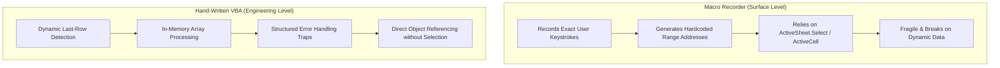

# VBA (Visual Basic for Applications)

> [!important]
> **Summary Statement**: Visual Basic for Applications (VBA) is an event-driven, object-oriented programming language embedded inside Microsoft Office applications to automate tasks, extend workbook functions, and build custom business tools.

---

## 📖 Definition & Why It Matters
- **Formal Definition**: Microsoft's legacy COM-based programming language that provides programmatic access to the host application's Document Object Model (DOM).
- **Why It Matters**: While Excel formulas compute values within cells, VBA controls the environment itself: opening files, spawning UserForms, transforming data structures in memory, communicating with Outlook/Word, and orchestrating full business pipelines.
- **Ecosystem Positioning**: VBA sits between front-end spreadsheet manipulation and back-end database engineering, serving as the ultimate glue language inside corporate desktop environments.

---

## 🧠 Personal Understanding Layer
1. **Official / Technical Explanation**: VBA executes via an in-process interpreter, interacting with Excel's C++ core via COM interfaces.
2. **My Understanding**: VBA is the backstage control panel for Excel. Instead of clicking menus and dragging formulas, VBA lets me command Excel through code.
3. **Simple Analogy**: Excel is a car. Formulas and manual mouse clicks are like steering and using the pedals. VBA is the autonomous driving computer programmed to run the entire route.
4. **Real Example**: Iterating through 50 regional store files, pulling specific revenue lines, aggregating them into a master report, and emailing summaries to regional managers.
5. **Where I Can Use It**: Operational data pipelines where external tools (Python/Databricks) cannot be deployed due to IT restrictions or locked-down corporate laptops.

---

## 🗺️ Mental Model: Macros vs. VBA

---

## 🔗 Connected Notes
- **Development Environment**: [[Visual Basic Editor]]
- **Object Layer**: [[VBA Object Model]]
- **Data Engineering Perspective**: [[VBA for Data Analysts]]
