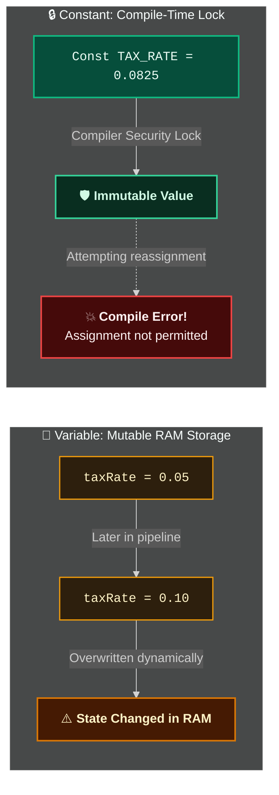

# Constants (`Const` Statement)

> [!important]
> **Summary Statement**: A **Constant** is a named memory location whose value is established at compile time and **cannot be altered** during macro execution. Using constants eliminates dangerous "magic numbers" and centralizes business logic.

---

## 🧠 Mental Model: The Whiteboard vs. The Stone Carving

<div class="vba-grid-2">

<div class="vba-card" style="border-top: 3px solid #f59e0b;">
<div class="vba-card-header" style="color: #f59e0b;">📝 Variable (Dry-Erase Whiteboard)</div>

```vba
Dim taxRate As Double
taxRate = 0.05
' ... 50 lines later ...
taxRate = 0.10  ' Value overwritten!
```

- **Nature**: Mutable RAM address.
- **Risk**: Any routine can accidentally reassign the value.
- **Role**: Dynamic counters, loop indices, temporary metrics.
</div>

<div class="vba-card" style="border-top: 3px solid #10b981;">
<div class="vba-card-header" style="color: #10b981;">🗿 Constant (Carved in Granite)</div>

```vba
Const TAX_RATE As Double = 0.0825
' Attempting reassignment:
' TAX_RATE = 0.10
' 💥 Compile Error: Assignment to constant not permitted!
```

- **Nature**: Immutable compile-time token.
- **Safety**: Locked by compiler; 100% immune to runtime side-effects.
- **Role**: Tax rates, server URLs, business rules.
</div>

</div>



---

## 💻 Syntax & Scope Levels

```vba
Option Explicit

' 1. Global / Project Constant (Accessible everywhere across all modules)
Public Const APP_TITLE As String = "Enterprise Reporting Pipeline v2.4"
Public Const DEFAULT_TAX_RATE As Double = 0.0825

' 2. Module-Level Constant (Accessible only within this module)
Private Const MAX_BATCH_SIZE As Long = 5000
Private Const LOG_SHEET_NAME As String = "System_Logs"

Sub ProcessInvoice()
    ' 3. Procedure-Level / Local Constant (Accessible only inside this Sub)
    Const DISCOUNT_THRESHOLD As Double = 1000#
    Const DISCOUNT_RATE As Double = 0.15
    
    Dim orderAmount As Double
    orderAmount = Range("B10").Value
    
    If orderAmount >= DISCOUNT_THRESHOLD Then
        Range("B11").Value = orderAmount * (1 - DISCOUNT_RATE)
    End If
End Sub
```

---

## 🏛️ Built-In Excel & VBA Constants

VBA and Excel come equipped with thousands of built-in constants. Always use these instead of raw integer codes:

| Built-In Constant | Underlying Value | Meaning / Usage |
| :--- | :---: | :--- |
| `xlUp` | `-4162` | Direction for `.End(xlUp)` (Last row search) |
| `xlToLeft` | `-4159` | Direction for `.End(xlToLeft)` (Last column search) |
| `xlCalculationManual` | `-4135` | Suspends automatic Excel calculations for speed |
| `xlCalculationAutomatic`| `-4105` | Restores automatic calculation |
| `vbNullString` | *Zero-length pointer* | Cleanest, fastest representation of empty text (faster than `""`!) |
| `vbInformation` | `64` | Displays blue info icon on `MsgBox` |
| `vbCritical` | `16` | Displays red stop icon on `MsgBox` |
| `vbOKCancel` | `1` | Displays OK and Cancel buttons |

> [!tip]
> **Pro Performance Tip**: Always use `vbNullString` instead of `""` when clearing strings or checking for empty strings. `""` allocates 4 to 6 bytes in the BSTR string table in memory; `vbNullString` is a null pointer with **zero memory allocation overhead**!

---

## 🛡️ Why Clean-Code Engineers Insist on Constants

1. **Self-Documenting Code**:
   - Bad: `If status = 3 And days > 45 Then` (What is 3? What is 45?)
   - Clean: `If status = STATUS_REJECTED And days > MAX_GRACE_PERIOD_DAYS Then`
2. **Instant Refactoring**: If the sales tax changes from 8.25% to 8.75%, you change one line at the top of your module rather than searching through 4,000 lines of code.
3. **Compile-Time Safety**: If you accidentally try to write `TAX_RATE = 0.09` halfway through your macro, the VBA compiler immediately stops you with:
   `Compile error: Assignment to constant not permitted`.

---

## 🧪 Active Recall Quiz

> [!question]- Can a Constant be assigned the result of a function at runtime (e.g., `Const TODAY_DATE = Date()`)? *(Click to expand)*
> **Answer**: **No!**  
> *Explanation*: In VBA, constants must be resolved by the compiler at compile-time using literal values or arithmetic expressions composed exclusively of other literals (e.g., `Const SECONDS_PER_DAY = 24 * 60 * 60`). They cannot call runtime functions or read cell values.

---

## 🔗 Connected Notes
- **Variables**: [[Variables]]
- **Data Types**: [[Data Types]]
- **Declaration Rules**: [[Dim Statement]], [[Option Explicit]]
- **Scope & Lifetime**: [[Scope]]
