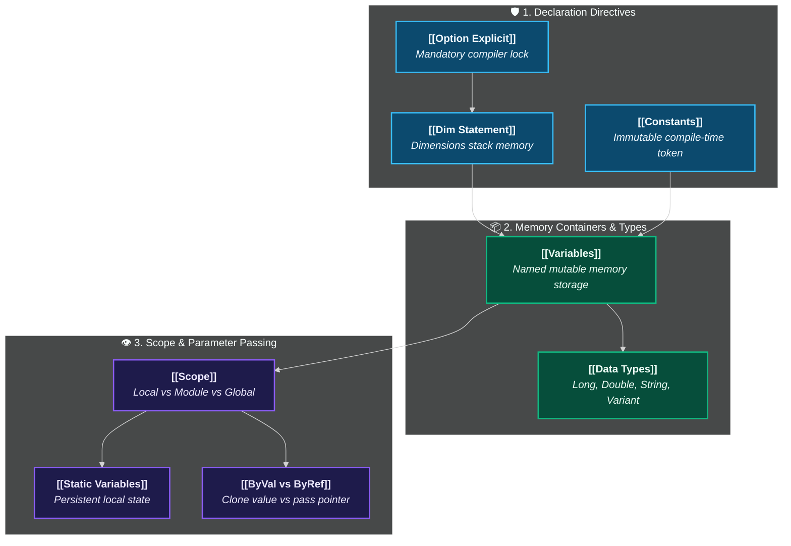

# Variables & Data Types Architecture Hub

> [!important]
> **Foundational Pillar**: Before writing loops, automating reporting workbooks, or handling API calls, you must master how Excel VBA allocates, manages, and protects data in RAM.

---

## 🗺️ Architectural Concept Map

---

## 🧭 Core Concept Knowledge Grid

📦 [[Variables]]

Named RAM storage for dynamic values and Excel objects (`Range`, `Worksheet`). Learn the `Set` keyword for objects and the Comma Trap.

📊 [[Data Types]]

Byte allocations and bounds. Why `Long` has superseded `Integer` in 32/64-bit systems, and when to avoid `Variant` bloat.

🛡️ [[Option Explicit]]

The non-negotiable directive that forces explicit variable declaration, preventing silent typo bugs and memory leaks.

🔒 [[Constants]]

Eliminate "magic numbers" by binding unchanging values to names at compile-time (`Const TAX_RATE As Double = 0.0825`).

👁️ [[Scope]]

The 4-level visibility and lifetime hierarchy (Local, Static, Module-Private, Project-Public) and the risk of VBA state resets.

🔄 [[ByVal vs ByRef]]

Understand memory addresses vs value cloning when passing parameters, and why VBA defaults to dangerous `ByRef`.

---

## 📊 Quick Reference: Primitive Types & Memory Footprint

| Data Type | Suffix | Bytes in RAM | Range / Values | Primary Excel Use Case |
| :--- | :---: | :---: | :--- | :--- |
| **`Long`** | `&` | 4 bytes | -2,147,483,648 to 2,147,483,647 | **Row counters**, loop indices, record IDs |
| **`Double`** | `#` | 8 bytes | ~1.797 × 10^308 (15 digits precision) | **Financial amounts**, currency, percentages |
| **`String`** | `$` | 10 bytes + 2/char | Up to ~2 billion characters | Names, file paths, status codes |
| **`Boolean`** | None | 2 bytes | `True` (-1) or `False` (0) | Status flags, condition checks |
| **`Date`** | None | 8 bytes | Jan 1, 100 to Dec 31, 9999 | Timestamps, report dates, deadlines |
| **`Variant`** | None | 16-24 bytes | Anything (dynamic) | Excel range arrays, error values, missing args |

---

## 🔗 Connected Navigation
- **Syntax Hub**: [[VBA Syntax]]
- **Procedures Hub**: [[Procedures & Functions]]
- **Object Hierarchy**: [[VBA Object Model]]
- **Course Section**: [[Section 05 - Working with Variables]]
