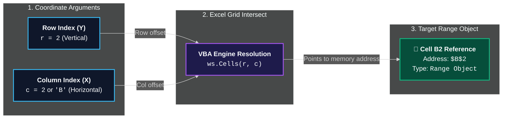

# The `Cells` Property (Coordinate-Based Referencing)

> [!important]
> **Summary Statement**: `Cells(row, column)` references an individual cell using numeric coordinate indexes (`RowIndex, ColumnIndex`). Because both arguments accept integer variables, `Cells` is the essential primitive for programmatic looping, grid traversal, and dynamic boundary calculations.

---

## 🧭 Visual Mental Model: The Coordinate Plane

<div class="vba-sheet-mockup">
  <div class="vba-sheet-header">
    <div class="vba-window-dots">
      <span class="vba-dot vba-dot-red"></span>
      <span class="vba-dot vba-dot-yellow"></span>
      <span class="vba-dot vba-dot-green"></span>
    </div>
    <div class="vba-sheet-title">📊 Active Worksheet: <code>ws.Cells(RowIndex, ColumnIndex)</code></div>
    <div></div>
  </div>
  
  <div class="vba-formula-bar">
    <div class="vba-name-box">B2</div>
    <div class="vba-fx-icon">fx</div>
    <div class="vba-formula-input"><code>=ws.Cells(2, 2).Value</code> &nbsp; <span style="color:#64748b;">(Row 2, Column 2 / Col B)</span></div>
  </div>

  <table class="vba-sheet-table">
    <thead>
      <tr>
        <th class="vba-row-hdr" style="background:#0f1117 !important;">#</th>
        <th class="vba-col-hdr">Col A <span class="idx">Index 1</span></th>
        <th class="vba-col-hdr" style="background:rgba(16,124,65,0.2) !important; color:#6ee7b7 !important;">Col B <span class="idx" style="color:#a7f3d0;">Index 2</span></th>
        <th class="vba-col-hdr">Col C <span class="idx">Index 3</span></th>
        <th class="vba-col-hdr">Col D <span class="idx">Index 4</span></th>
      </tr>
    </thead>
    <tbody>
      <tr>
        <td class="vba-row-hdr">Row 1</td>
        <td class="vba-cell">
          <div class="vba-cell-addr">A1</div>
          <div class="vba-cell-coord">Cells(1, 1)</div>
        </td>
        <td class="vba-cell">
          <div class="vba-cell-addr">B1</div>
          <div class="vba-cell-coord">Cells(1, 2)</div>
        </td>
        <td class="vba-cell">
          <div class="vba-cell-addr">C1</div>
          <div class="vba-cell-coord">Cells(1, 3)</div>
        </td>
        <td class="vba-cell">
          <div class="vba-cell-addr">D1</div>
          <div class="vba-cell-coord">Cells(1, 4)</div>
        </td>
      </tr>
      <tr>
        <td class="vba-row-hdr" style="background:rgba(16,124,65,0.2) !important; color:#6ee7b7 !important;">Row 2</td>
        <td class="vba-cell">
          <div class="vba-cell-addr">A2</div>
          <div class="vba-cell-coord">Cells(2, 1)</div>
        </td>
        <td class="vba-cell active-target">
          <div class="vba-cell-addr">🎯 B2</div>
          <div class="vba-cell-coord">Cells(2, 2)</div>
        </td>
        <td class="vba-cell">
          <div class="vba-cell-addr">C2</div>
          <div class="vba-cell-coord">Cells(2, 3)</div>
        </td>
        <td class="vba-cell">
          <div class="vba-cell-addr">D2</div>
          <div class="vba-cell-coord">Cells(2, 4)</div>
        </td>
      </tr>
      <tr>
        <td class="vba-row-hdr">Row 3</td>
        <td class="vba-cell">
          <div class="vba-cell-addr">A3</div>
          <div class="vba-cell-coord">Cells(3, 1)</div>
        </td>
        <td class="vba-cell">
          <div class="vba-cell-addr">B3</div>
          <div class="vba-cell-coord">Cells(3, 2)</div>
        </td>
        <td class="vba-cell">
          <div class="vba-cell-addr">C3</div>
          <div class="vba-cell-coord">Cells(3, 3)</div>
        </td>
        <td class="vba-cell">
          <div class="vba-cell-addr">D3</div>
          <div class="vba-cell-coord">Cells(3, 4)</div>
        </td>
      </tr>
    </tbody>
  </table>
  
  <div class="vba-axis-bar">
    <div class="vba-axis-badge"><span>⬇️</span> <b>1st Argument:</b> Row Number (Vertical / Y-Axis)</div>
    <div class="vba-axis-badge"><span>➡️</span> <b>2nd Argument:</b> Column Number or Letter (Horizontal / X-Axis)</div>
  </div>
</div>



Unlike mathematical Cartesian coordinates `(X, Y)`, Excel VBA's `Cells` convention is **Row First, Column Second** `(Y, X)`:
- `Cells(5, 2)` = Row 5, Column 2 (**Cell B5**).
- `Cells(10, "C")` = Row 10, Column C (**Cell C10**). *(Column letter strings are supported!)*

---

## ⚖️ `Range` vs. `Cells` vs. Hybrid Bounding Box

| Syntax Pattern | Code Example | When to Use |
| :--- | :--- | :--- |
| **`Range` by Address** | `ws.Range("B2:F20")` | Fixed blocks, headers, named ranges known at design time |
| **`Cells` by Coordinates** | `ws.Cells(r, c)` | Single-cell reading/writing inside dynamic `For` loops |
| **`Cells` with Column Letter** | `ws.Cells(r, "D")` | Dynamic rows where the column business field is fixed |
| **Hybrid Bounding Box** | `ws.Range(ws.Cells(1, 1), ws.Cells(lastRow, lastCol))` | **The Gold Standard**: Creating a dynamic multi-cell rectangle between two computed coordinates! |

---

## 💻 Core Code Patterns with `Cells`

### 1. The Classic Last Row Detection Anchor
To find the bottom-most data row in Column A without hardcoding 65536 or 1048576:
```vba
Dim lastRow As Long
' ws.Rows.Count returns 1,048,576 in modern Excel
lastRow = ws.Cells(ws.Rows.Count, "A").End(xlUp).Row
```

---

### 2. Matrix Traversal (2D Nested Loop)
```vba
Option Explicit

Sub AuditGridValues()
    Dim ws As Worksheet: Set ws = ThisWorkbook.Sheets("Matrix")
    Dim r As Long, c As Long
    
    ' Loop rows 2 to 100, columns 1 to 10
    For r = 2 To 100
        For c = 1 To 10
            If ws.Cells(r, c).Value < 0 Then
                ' Highlight negative variances in red
                ws.Cells(r, c).Interior.Color = RGB(255, 200, 200)
                ws.Cells(r, c).Font.Color = RGB(180, 0, 0)
            End If
        Next c
    Next r
End Sub
```

---

### 3. The Hybrid Dynamic Range Constructor
When copying, sorting, or formatting an entire table whose height and width are both dynamic:
```vba
Dim firstCell As Range
Dim lastCell As Range
Dim fullTable As Range

Set firstCell = ws.Cells(1, 1)                      ' Top-left (A1)
Set lastCell = ws.Cells(lastRow, lastCol)           ' Bottom-right corner

' Form the unified Range object:
Set fullTable = ws.Range(firstCell, lastCell)

' Format borders on the whole block in one call:
fullTable.Borders.LineStyle = xlContinuous
```

---

## ⚠️ The Qualification Gotcha with Hybrid Ranges

When writing `ws.Range(Cells(1,1), Cells(lastRow, lastCol))`, novices frequently write:
```vba
' ❌ RUNTIME ERROR 1004 TRAP:
Sheets("Summary").Range(Cells(1, 1), Cells(10, 5)).Value = 0
```
> [!danger]
> **Why it fails**: `Sheets("Summary").Range(...)` belongs to Summary, but the inner `Cells(1,1)` is **unqualified**, so Excel assumes it belongs to the `ActiveSheet`! If the ActiveSheet is NOT "Summary", you are asking Excel to create a Range spanning two completely different worksheets, triggering:  
> `Run-time error 1004: Method 'Range' of object '_Worksheet' failed`.
> 
> **The Fix**: Qualify every child object with `ws.` or use `With ws`:
> ```vba
> With Sheets("Summary")
>     .Range(.Cells(1, 1), .Cells(10, 5)).Value = 0
> End With
> ```

---

## 🧪 Active Recall Check

> [!question]- In modern Excel (XLSX/XLSM), what value does `Cells(Rows.Count, 1).Row` return? *(Click to expand)*
> **Answer**: `1,048,576` (The total number of rows available in Excel 2007+).

> [!question]- Is `Cells("A", 1)` valid VBA syntax? *(Click to expand)*
> **Answer**: **No!** The syntax is `Cells(Row, Column)`. Row must always be an integer number. `Cells(1, "A")` is valid, but `Cells("A", 1)` will throw a `Type Mismatch` error.

---

## 🔗 Connected Notes
- **Range Object**: [[Range]]
- **Sheet Architecture**: [[Worksheet]], [[Worksheets]]
- **Looping Constructs**: [[For Next]], [[Cheat Sheets/Loops Cheat Sheet|Loops Cheat Sheet]]
- **Array Memory Processing**: [[Arrays]], [[Arrays]]
