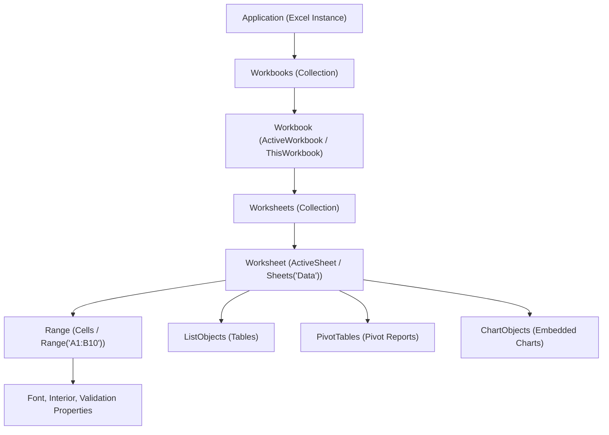

# VBA Object Model

> [!important]
> **Summary Statement**: The Excel Object Model is a hierarchical tree of objects representing every element of the Excel application (application, workbooks, worksheets, ranges, charts, tables), exposing their properties and methods to VBA.

---

## 🗺️ Object Hierarchy Tree

---

## 🔑 Objects, Collections, Properties, and Methods
1. **Object**: A physical element in Excel (e.g., `Workbook`, `Worksheet`, `Range`).
2. **Collection**: An object containing a group of related objects (e.g., `Worksheets`, `Workbooks`, `Cells`). Plural naming convention.
3. **Property**: An attribute describing the object (nouns/adjectives: `.Value`, `.Name`, `.Color`, `.Count`).
4. **Method**: An action the object can perform (verbs: `.Copy`, `.Paste`, `.Delete`, `.ClearContents`, `.SaveAs`).

---

## 🧠 Personal Understanding Layer
- **Analogy**: 
  - Application = The Universe / Country
  - Workbook = The City / Building
  - Worksheet = The Floor / Room
  - Range = The Desk or Specific Drawer
  - Property = What color is the desk? How wide is it?
  - Method = Clean the desk! Move the desk!
- **Golden Rule**: Fully qualified references prevent disastrous ambiguity. Instead of `Range("A1").Value`, use `wsTarget.Range("A1").Value`.

---

## 🔗 Connected Notes
- [[Application]], [[Workbook]], [[Worksheet]], [[Range]], [[Cells]]
