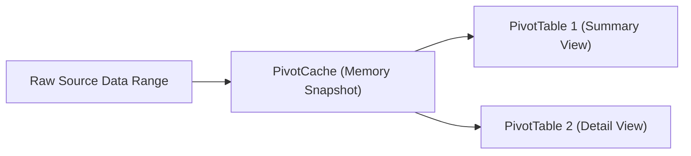

# PivotTables

> [!important]
> **Summary Statement**: The `PivotTable` object in VBA allows automated creation, manipulation, source data updating, and refreshing of interactive aggregated summaries.

---

## 🏗️ Architecture: PivotCache vs. PivotTable



> [!tip]
> Multiple PivotTables built from the same data should share a single `PivotCache` to reduce file size and accelerate refresh times.

---

## 💻 Refreshing All PivotTables via Code
```vba
' Refresh all Pivot Caches across the entire workbook
Dim pc As PivotCache
For Each pc In ThisWorkbook.PivotCaches
    pc.Refresh
Next pc
```

---

## 🔗 Connected Notes
- [[Pivot Automation]], [[Project 02 - Regional Sales Reporting Tool]]
