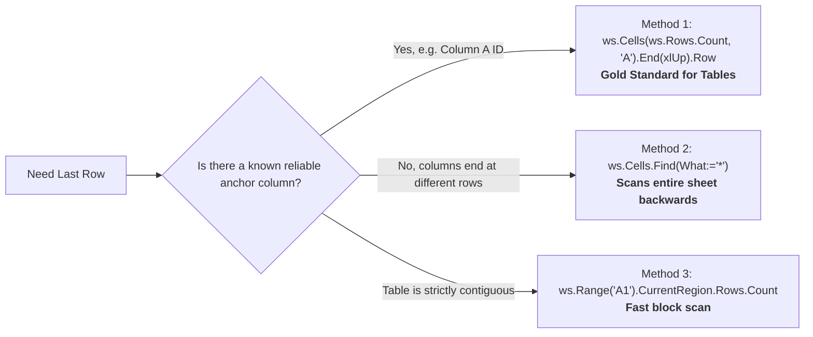

# The `Range` Object (Architecture, Referencing & Manipulation)

> [!important]
> **Summary Statement**: The `Range` object represents any individual cell, row, column, contiguous block, or 3D slice across worksheets. It is the workhorse of Excel VBA automation. Mastering how to reference, offset, resize, and bulk-load Ranges without touching the clipboard or using `.Select` separates novice macro-recorders from professional automation engineers.

---

## 🧭 Visual Mental Model: Navigation, Offset & Resize

```mermaid
flowchart TD
    subgraph Base["1. Anchor Cell: ws.Range('B2')"]
        B["Cell B2"]
    end

    subgraph Nav["2. Navigation: .Offset(Row, Col)"]
        direction TB
        B -->|Offset(2, 3)| OFF["Land on E4<br/><i>(Shift 2 rows DOWN, 3 cols RIGHT)</i>"]
    end

    subgraph Res["3. Expansion: .Resize(NumRows, NumCols)"]
        direction TB
        OFF -->|Resize(5, 2)| RES["Block E4:F8<br/><i>(Expand 5 rows tall, 2 cols wide)</i>"]
    end

    style Base fill:#181a24,stroke:#38bdf8,stroke-width:2px
    style Nav fill:#12141c,stroke:#f59e0b,stroke-width:2px
    style Res fill:#10121a,stroke:#10b981,stroke-width:2px
```

---

## 🎯 4 Robust Methods to Find Last Used Row (With Pros & Cons)

In dynamic reporting pipelines, raw data row counts change on every run. Hardcoding row bounds (`Range("A2:A100")`) is the #1 cause of broken automation.



| Method | Syntax | Strengths | Failure Mode / Caveats |
| :--- | :--- | :--- | :--- |
| **1. `End(xlUp)`** ⭐ | `ws.Cells(ws.Rows.Count, "A").End(xlUp).Row` | Exact analog to <kbd>Ctrl</kbd>+<kbd>↑</kbd>. Fast, reliable, immune to blanks in middle of column. | Fails if data in Column A is missing while other columns are longer. |
| **2. `Find(*)`** | `ws.Cells.Find(What:="*", LookIn:=xlFormulas, SearchOrder:=xlByRows, SearchDirection:=xlPrevious).Row` | True sheet-wide last row across **all** columns combined. | Slightly more verbose syntax; can fail if entire worksheet is completely empty. |
| **3. `CurrentRegion`** | `ws.Range("A1").CurrentRegion.Rows.Count` | Instant block dimensioning (<kbd>Ctrl</kbd>+<kbd>A</kbd>). | Completely derailed if user leaves a blank row or blank column inside the table! |
| **4. `SpecialCells`** | `ws.Cells.SpecialCells(xlCellTypeLastCell).Row` | Built-in Excel pointer. | ⚠️ **Dangerous**: Retains memory of formatted or deleted cells; often reports row 10,000 when only 50 rows have data! |

---

## 🔬 Syntax Patterns: `Range` vs. `Cells`

<div class="vba-grid-2">

<div class="vba-card">
<div class="vba-card-header">🔤 When to Use Range("A1")</div>

- Static references known at design time (`ws.Range("HeaderTitle")`)
- Named Ranges (`ws.Range("tbl_Sales[Revenue]")`)
- Multi-cell ranges by A1 notation (`ws.Range("A2:F50")`)
- Calling built-in Excel address formulas
</div>

<div class="vba-card">
<div class="vba-card-header">🔢 When to Use Cells(Row, Col)</div>

- Looping by integer indices (`ws.Cells(r, c)`)
- Dynamic column indexing (`ws.Cells(1, colIndex)`)
- Inside `ws.Range(Cells(...), Cells(...))` to construct dynamic two-corner bounding boxes!
</div>

</div>

### The Dynamic Bounding Box Pattern
```vba
' Combine Range and Cells to select from top-left to dynamically computed bottom-right:
Dim startCell As Range
Dim endCell As Range
Dim dataBlock As Range

Set startCell = ws.Cells(2, 1)                      ' Cell A2
Set endCell = ws.Cells(lastRow, lastCol)            ' Cell F1500
Set dataBlock = ws.Range(startCell, endCell)        ' Range("A2:F1500")
```

---

## ⚠️ The Qualification Trap: The #1 Silent Bug in VBA

```vba
' ❌ DANGEROUS: Unqualified Range and Cells
Sub CorruptActiveSheet()
    ' If the user clicks a different workbook, this writes to the WRONG book!
    Range("A1:B10").Value = 0
    Cells(1, 1).Value = "Test"
End Sub

' ✅ BULLETPROOF: Fully Qualified Object Hierarchy
Sub BulletproofAutomation()
    Dim wb As Workbook: Set wb = ThisWorkbook
    Dim ws As Worksheet: Set ws = wb.Sheets("Monthly_Data")
    
    ' Explicitly attached to ws:
    ws.Range("A1:B10").Value = 0
    ws.Cells(1, 1).Value = "Test"
End Sub
```

> [!danger]
> **The Golden Rule of Automation**: If you don't prefix `Range` or `Cells` with `ws.`, Excel binds to `Application.ActiveSheet`. If an event, timer, or user clicks away during a 20-second run, your macro will overwrite the active sheet in whatever document is open!

---

## ⚡ Direct Value Transfer vs. Clipboard (Speed Multiplier)

```vba
' ❌ SLOW & BRITTLE: Uses OS Clipboard, flashes screen, requires selection
Range("A2:D50000").Select
Selection.Copy
Sheets("Archive").Select
Range("A2").Select
ActiveSheet.Paste
Application.CutCopyMode = False

' ✅ LIGHTNING FAST (100x Faster): Headless In-Memory Assignment
Dim rowCount As Long: rowCount = 50000
Sheets("Archive").Range("A2:D" & (rowCount + 1)).Value = _
    Sheets("Source").Range("A2:D" & (rowCount + 1)).Value
```

---

## 🚀 The Enterprise Memory Jump: Range to 2D Variant Array

Iterating over 100,000 cells one by one with `Cells(r, c).Value` takes **minutes**. Dumping the entire Range into a 2D Variant array takes **0.05 seconds**:

```vba
Option Explicit

Sub ProcessHighVolumeRange()
    Dim ws As Worksheet: Set ws = ThisWorkbook.Sheets("Raw_Data")
    Dim lastRow As Long: lastRow = ws.Cells(ws.Rows.Count, "A").End(xlUp).Row
    
    ' 1. Read entire Range into RAM in a single CPU instruction!
    Dim dataArr As Variant
    dataArr = ws.Range("A2:D" & lastRow).Value
    
    ' 2. Loop through array in memory (Microseconds per loop)
    Dim r As Long
    For r = 1 To UBound(dataArr, 1)
        dataArr(r, 4) = dataArr(r, 2) * dataArr(r, 3) ' Revenue = Units * Price
    Next r
    
    ' 3. Write modified array back to worksheet in a single shot!
    ws.Range("A2:D" & lastRow).Value = dataArr
End Sub
```

---

## 🧪 Active Recall Challenge

> [!question]- If `Set r = ws.Range("C5")`, what is the address of `r.Offset(2, -1).Resize(3, 2)`? *(Click to expand)*
> **Answer**: `ws.Range("B7:C9")`
> 
> *Step-by-step trace*:
> 1. Start at **C5** (Row 5, Col 3).
> 2. `Offset(2, -1)`: Move down 2 rows (5 + 2 = 7), move left 1 column (3 - 1 = 2 / Col B) → lands on **B7**.
> 3. `Resize(3, 2)`: Starting from B7, make it 3 rows tall (Rows 7, 8, 9) and 2 columns wide (Cols B, C) → **B7:C9**!

---

## 🔗 Connected Notes
- **Individual Cells**: [[Cells]]
- **Sheet Architecture**: [[Worksheet]], [[Worksheets]]
- **In-Memory Arrays**: [[Arrays]], [[05 - Data & Automation/Arrays/Dynamic Arrays]]
- **Performance Tuning**: [[Performance Optimization]]
- **Cookbook Patterns**: [[Code Cookbook/Patterns/Last Used Row and Column]]
