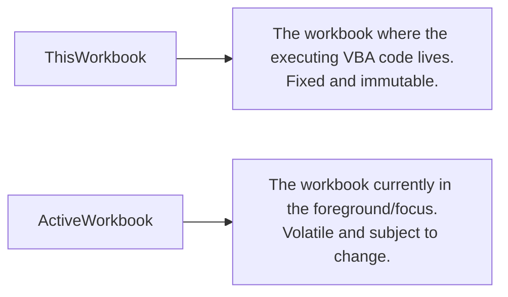

# Workbook Object

> [!important]
> **Summary Statement**: The `Workbook` object represents an individual Excel file (`.xlsx`, `.xlsm`, `.xlsb`), serving as the container for worksheets, named ranges, charts, and VBA code modules.

---

## ⚖️ `ThisWorkbook` vs. `ActiveWorkbook`



> [!warning]
> **Never confuse `ThisWorkbook` and `ActiveWorkbook`!**
> If your macro opens a customer file, `ActiveWorkbook` shifts to the customer file, but `ThisWorkbook` continues to point to your automation master file.

---

## 💻 Common Workbook Operations

```vba
Dim wbSource As Workbook
Dim wbTarget As Workbook

' Open an external file
Set wbSource = Workbooks.Open("C:\Reports\Sales_East.xlsx")

' Reference the automation tool workbook
Set wbTarget = ThisWorkbook

' Create a new blank workbook
Dim wbNew As Workbook
Set wbNew = Workbooks.Add

' Save and close
wbSource.Close SaveChanges:=False
wbNew.SaveAs Filename:="C:\Reports\Consolidated.xlsx", FileFormat:=xlOpenXMLWorkbook
```

---

## 🔗 Connected Notes
- [[Worksheet]], [[VBA Object Model]], [[File Automation]]
