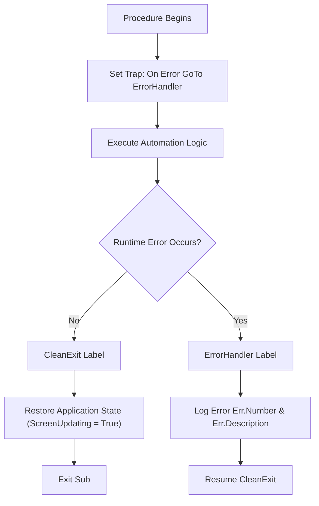

# Error Handling

> [!important]
> **Summary Statement**: Error handling intercepts runtime exceptions gracefully, prevents ugly system crash dialogues, logs diagnostic information, and guarantees restoration of Excel's application state.

---

## 🛡️ Production Error Handling Architecture



---

## 💻 Standard Production Boilerplate
```vba
Option Explicit

Public Sub EnterpriseProductionProcedure()
    On Error GoTo ErrorHandler
    
    ' 1. Defensive State Setup
    Application.ScreenUpdating = False
    Application.DisplayAlerts = False
    
    ' 2. Core Business Logic
    ' ...
    
CleanExit:
    ' 3. Guaranteed State Restoration
    Application.ScreenUpdating = True
    Application.DisplayAlerts = True
    Exit Sub
    
ErrorHandler:
    ' 4. Logging & Notification
    MsgBox "An error occurred in " & Err.Source & vbCrLf & _
           "Error #" & Err.Number & ": " & Err.Description, _
           vbCritical, "Automation Error"
    Resume CleanExit
End Sub
```

---

## 🔗 Connected Notes
- [[Debugging]], [[Defensive Programming]], [[VBA Troubleshooting Matrix]]
