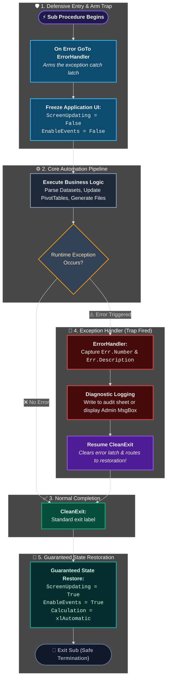

# Error Handling Architecture (`On Error` & The `Err` Object)

> [!important]
> **Summary Statement**: Error handling intercepts runtime exceptions gracefully, prevents abrupt application crashes, logs diagnostic intelligence, protects user trust, and **guarantees the restoration of Excel application state** (`ScreenUpdating`, `Calculation`, `EnableEvents`).

---

## 🛡️ Production Lifecycle Architecture



---

## 🧭 The 4 Error Directives Compared

| Directive | Exact Behavior | When to Use |
| :--- | :--- | :--- |
| **`On Error GoTo <Label>`** | Jumps immediately to labeled error handling block when an error occurs | Standard in every public procedure and main macro |
| **`On Error Resume Next`** | Silently ignores any error and continues to the very next line | **Only for surgical checks** (e.g., verifying if a worksheet exists) |
| **`On Error GoTo 0`** | **Disables the active error handler**; returns to default Excel error dialog | Immediately after an `On Error Resume Next` block to close the blind spot! |
| **`On Error GoTo -1`** | **Clears the active exception latch in memory** | Needed when writing multi-try loop recovery logic |

---

## 🔬 The Surgical `On Error Resume Next` Pattern

Never wrap an entire 500-line macro in `On Error Resume Next`. It blinds you to critical bugs and corrupts data silently. Instead, use the **Surgical Sandbox Pattern**:

```vba
Option Explicit

' Test if a worksheet exists without causing a runtime crash:
Function WorksheetExists(ByVal sheetName As String, _
                         Optional ByVal wb As Workbook = Nothing) As Boolean
    Dim ws As Worksheet
    If wb Is Nothing Then Set wb = ThisWorkbook
    
    ' 1. Open the blindfold ONLY for this one line
    On Error Resume Next
    Set ws = wb.Sheets(sheetName)
    
    ' 2. IMMEDIATELY close the blindfold!
    On Error GoTo 0
    
    ' 3. Inspect if the assignment succeeded
    WorksheetExists = Not (ws Is Nothing)
End Function
```

---

## 📋 Top 7 VBA Runtime Errors Every Developer Must Know

| Error # | Description | Common Root Cause | Defensive Remedy |
| :---: | :--- | :--- | :--- |
| **9** | `Subscript out of range` | Sheet name typo (`Sheets("Slaes")`) or array index beyond `UBound` | Check spelling; use `WorksheetExists()` |
| **11** | `Division by zero` | Calculation divided by an empty cell or zero | Add `If denominator <> 0 Then` |
| **13** | `Type mismatch` | Attempting to feed text string into a `Long` or `Double` | Check cell content with `IsNumeric()` |
| **91** | `Object variable or With block variable not set` | Forgot the `Set` keyword on an Object assignment (`ws = Sheet1`) | Add `Set` (`Set ws = Sheet1`) |
| **424** | `Object required` | Referencing a property on something that is not an object | Ensure variable is typed and instantiated |
| **438** | `Object doesn't support this property or method` | Calling `.Value2` on an Application object or misspelled property | Verify object type in Object Browser (<kbd>F2</kbd>) |
| **1004** | `Application-defined or object-defined error` | The generic Excel catch-all (locked sheet, invalid range address, sheet name contains `/`) | Check worksheet protection and range bounds |

---

## 💻 Complete Production Boilerplate (Copy-Paste Ready)

```vba
Option Explicit

Public Sub ProductionETLPipeline()
    ' Arm the trap
    On Error GoTo ErrorHandler
    
    ' 1. Capture original application states
    Dim origScreenUpdating As Boolean: origScreenUpdating = Application.ScreenUpdating
    Dim origEvents As Boolean: origEvents = Application.EnableEvents
    Dim origCalc As XlCalculation: origCalc = Application.Calculation
    
    ' 2. Defensive High-Performance Setup
    Application.ScreenUpdating = False
    Application.EnableEvents = False
    Application.Calculation = xlCalculationManual
    
    ' =====================================================================
    ' 3. CORE BUSINESS LOGIC
    ' =====================================================================
    Dim wsSource As Worksheet
    Set wsSource = ThisWorkbook.Sheets("Raw_Data")
    
    Dim lastRow As Long
    lastRow = wsSource.Cells(wsSource.Rows.Count, "A").End(xlUp).Row
    If lastRow < 2 Then Err.Raise 10001, "ProductionETL", "Source dataset is completely empty!"
    
    ' Transformation actions here...
    
CleanExit:
    ' =====================================================================
    ' 4. GUARANTEED RESTORATION (Always runs whether error occurred or not)
    ' =====================================================================
    Application.ScreenUpdating = origScreenUpdating
    Application.EnableEvents = origEvents
    Application.Calculation = origCalc
    Exit Sub

ErrorHandler:
    ' =====================================================================
    ' 5. CENTRALIZED ERROR DIAGNOSTICS & LOGGING
    ' =====================================================================
    Dim errMsg As String
    errMsg = "A runtime error occurred in: " & Err.Source & vbCrLf & _
             "Error #" & Err.Number & ": " & Err.Description & vbCrLf & _
             "Line / Context: Processing row " & lastRow
             
    MsgBox errMsg, vbCritical, "Pipeline Exception Alert"
    
    ' Route safely back to CleanExit so Excel is never left frozen
    Resume CleanExit
End Sub
```

> [!caution]
> **Why `Resume CleanExit` is Mandatory**: If you don't route through `CleanExit`, your macro will terminate while `Application.ScreenUpdating = False` and `Application.EnableEvents = False`. Excel will look permanently frozen and unresponsive to the user!

---

## ⚡ Raising Custom Errors (`Err.Raise`)

You can create your own custom domain errors using `Err.Raise`:
```vba
If Not FileExists(filePath) Then
    ' Custom error numbers should be vbObjectError + offset (e.g. 513 to 65535)
    Err.Raise vbObjectError + 513, "DataIngestionEngine", "The required CSV file was not found: " & filePath
End If
```

---

## 🧪 Active Recall Quiz

> [!question]- What happens if an error occurs while `On Error Resume Next` is active, and you do not call `On Error GoTo 0`? *(Click to expand)*
> **Answer**: Every subsequent error in that procedure will be **silently swallowed**. Your code will keep running on invalid or empty variables, causing subtle data corruption or unexpected behavior hundreds of lines later.

> [!question]- What is the crucial difference between `Exit Sub` and `Resume CleanExit` in an error handling block? *(Click to expand)*
> **Answer**: `Resume CleanExit` clears the active error state inside VBA's runtime engine before jumping to the label. If you use a simple `GoTo CleanExit` instead of `Resume`, VBA considers the procedure still in an "unhandled error condition", which will prevent subsequent error handlers from catching future errors!

---

## 🔗 Connected Notes
- **Debugging & Tools**: [[Debugging]], [[Immediate Window]], [[Locals Window]], [[Watch Window]]
- **Troubleshooting Guide**: [[VBA Troubleshooting Matrix]]
- **Defensive Design**: [[Defensive Programming]]
- **Scope & State Recovery**: [[Scope]]
