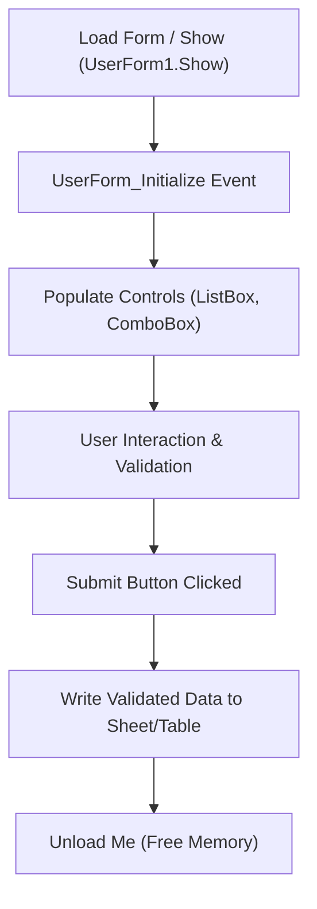

# UserForms

> [!important]
> **Summary Statement**: A UserForm is a custom dialog window or GUI window created in VBA that provides controlled data entry, input validation, search filtering, and guided workflows.

---

## 🏗️ UserForm Architecture & Lifecycle

---

## 🔗 Connected Notes
- [[ActiveX Controls]], [[ListBoxes]], [[Project 03 - Invoice Generation Tool]]
