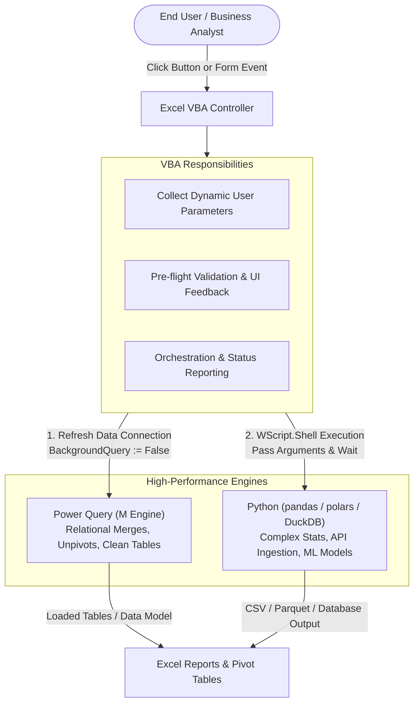

# Bridging VBA with Power Query and Python

> **Modern Data Engineering Principle**: Use VBA for what it does best (User Interface events, interactive UserForms, workbook packaging, file dialogs), and bridge to Power Query and Python for heavy data transformation, API calls, and complex analytics.

---

## 1. Architectural Overview



---

## 2. Refreshing Power Query Connections in VBA (Synchronously)

### The Critical Pitfall: Asynchronous Background Queries
By default, Excel refreshes data connections in the background. If VBA triggers a refresh and immediately runs subsequent formatting or export code, the subsequent code will execute **before the data finishes refreshing**, corrupting reports or capturing stale data.

### The Robust Synchronous Solution

```vba
Option Explicit

Public Sub RefreshPowerQuerySynchronously()
    Dim conn As WorkbookConnection
    Dim oQuery As Object
    
    On Error GoTo ErrorHandler
    Application.StatusBar = "Refreshing Power Query data pipelines..."
    Application.Cursor = xlWait
    
    ' Disable BackgroundQuery across all OLEDB / Data Model connections
    For Each conn In ThisWorkbook.Connections
        If conn.Type = xlConnectionTypeOLEDB Then
            conn.OLEDBConnection.BackgroundQuery = False
            conn.Refresh
        End If
    Next conn
    
    Application.StatusBar = "Power Query refresh completed successfully."
    MsgBox "All data pipeline connections successfully refreshed!", vbInformation, "ETL Complete"
    
CleanExit:
    Application.Cursor = xlDefault
    Application.StatusBar = False
    Exit Sub
    
ErrorHandler:
    MsgBox "Error refreshing pipeline: " & Err.Description, vbCritical, "Refresh Error"
    Resume CleanExit
End Sub
```

---

## 3. Orchestrating Python from Excel VBA

### When to Bridge to Python:
1. Fetching data from REST APIs with OAuth2 authentication.
2. Running complex transformations that would cause VBA to choke (e.g., regex matching on 500,000 strings).
3. Statistical modeling, forecasting, or machine learning (scikit-learn, statsmodels).

### VBA Execution Engine (WScript.Shell)

```vba
Option Explicit

Public Sub RunPythonDataPipeline()
    Dim wsh As Object
    Dim pythonExePath As String
    Dim scriptPath As String
    Dim projectDir As String
    Dim commandLine As String
    Dim exitCode As Long
    
    On Error GoTo ErrorHandler
    
    ' 1. Identify Environment & Script Paths
    projectDir = ThisWorkbook.Path
    pythonExePath = "python" ' Or explicit virtualenv path: projectDir & "\.venv\Scripts\python.exe"
    scriptPath = projectDir & "\scripts\etl_processor.py"
    
    ' Check if script exists
    If Dir(scriptPath) = "" Then
        MsgBox "Cannot find Python script: " & scriptPath, vbCritical, "Script Missing"
        Exit Sub
    End If
    
    ' 2. Build Execution Command Line (Invisible Window & Synchronous Wait)
    ' Format: python.exe "path\to\script.py" "arg1" "arg2"
    commandLine = """" & pythonExePath & """ """ & scriptPath & """ """ & projectDir & """"
    
    Application.StatusBar = "Executing Python Data Pipeline... Please wait."
    Application.Cursor = xlWait
    
    ' 3. Initialize Windows Script Host
    Set wsh = CreateObject("WScript.Shell")
    
    ' Parameters: Run(Command, WindowStyle, WaitOnReturn)
    ' WindowStyle: 0 = Hidden, 1 = Normal
    ' WaitOnReturn: True halts VBA execution until Python terminates
    exitCode = wsh.Run(commandLine, 0, True)
    
    If exitCode = 0 Then
        Application.StatusBar = "Python execution succeeded."
        MsgBox "Python pipeline executed successfully!", vbInformation, "Pipeline Complete"
    Else
        MsgBox "Python script exited with error code: " & exitCode, vbCritical, "Pipeline Failed"
    End If

CleanExit:
    Set wsh = Nothing
    Application.Cursor = xlDefault
    Application.StatusBar = False
    Exit Sub

ErrorHandler:
    MsgBox "System Automation Error: " & Err.Description, vbCritical, "Automation Error"
    Resume CleanExit
End Sub
```

---

## 4. Architectural Best Practices

1. **Parameter Passing via JSON or CLI Arguments**: Avoid writing temporary data into arbitrary worksheet cells if possible. Pass paths and flags as command-line arguments to Python.
2. **Standard Output Logging**: Configure the Python script to write standard output and errors into an `execution.log` file in the project folder so business users can inspect errors without needing a terminal open.
3. **Graceful Fallbacks**: If Python is not installed on the user's workstation, catch exit codes and inform the user with actionable instructions rather than crashing the Excel host.

---

## 5. Related Notes
- [[Performance Optimization]]
- [[Cross-Application Automation]]
- [[Defensive Programming]]
- [[VBA for Data Analysts]]
