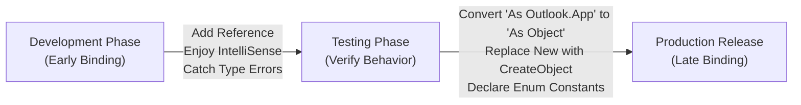

# Early vs Late Binding Architecture

> **Architectural Principle**: Bind early in development for IntelliSense, type checking, and performance; bind late in production distribution to eliminate broken references and version mismatches.

---

## 1. Technical Definition & Mental Model

When communicating with external COM automation servers (Outlook, Word, PowerPoint, Access, FileSystemObject, ADO, RegEx), VBA needs to know what methods, properties, and constants exist in the external object library.

| Feature | Early Binding | Late Binding |
| :--- | :--- | :--- |
| **Object Declaration** | `Dim olApp As Outlook.Application` | `Dim olApp As Object` |
| **Object Instantiation** | `Set olApp = New Outlook.Application` | `Set olApp = CreateObject("Outlook.Application")` |
| **Reference Required** | ✅ Must check Tools → References | ❌ No reference required |
| **IntelliSense Auto-complete**| ✅ Complete drop-down support | ❌ No IntelliSense |
| **Named Constants** | ✅ Built-in (e.g., `olMailItem`, `wdPasteDefault`)| ❌ Must declare manually (e.g., `Const olMailItem = 0`) |
| **Execution Performance** | ⚡ ~10–15% faster (Direct vtable dispatch) | 🐢 Slight overhead (IDispatch query for each call) |
| **Deployment Risk** | ⚠️ High: Fails with compile error if client has different Office version | 🛡️ Zero: Dynamically resolves at runtime on any Office version |

---

## 2. The Golden Rule of VBA Office Automation



---

## 3. Implementation Code Comparison

### Development: Early Binding (Requires Reference to Microsoft Outlook XX.0 Object Library)

```vba
Option Explicit

' Requires reference: Tools -> References -> Microsoft Outlook XX.0 Object Library
Public Sub SendDraftEmail_EarlyBinding()
    Dim olApp As Outlook.Application
    Dim olMail As Outlook.MailItem
    
    ' New keyword works because type definition is known at compile time
    Set olApp = New Outlook.Application
    Set olMail = olApp.CreateItem(olMailItem) ' olMailItem is an enum = 0
    
    With olMail
        .To = "finance-team@company.com"
        .Subject = "Automated Monthly Financial Digest"
        .Body = "Please find the enclosed monthly reporting package."
        .Display
    End With
    
    Set olMail = Nothing
    Set olApp = Nothing
End Sub
```

### Production: Late Binding (Zero References Required)

```vba
Option Explicit

Public Sub SendDraftEmail_LateBinding()
    ' 1. Declare explicitly as Object
    Dim olApp As Object
    Dim olMail As Object
    
    ' 2. Define Outlook Enum Constants locally (because late binding does not have them)
    Const olMailItem As Long = 0
    
    On Error GoTo CleanExit
    
    ' 3. Instantiate via CreateObject (or GetObject if already running)
    On Error Resume Next
    Set olApp = GetObject(, "Outlook.Application")
    If olApp Is Nothing Then
        Set olApp = CreateObject("Outlook.Application")
    End If
    On Error GoTo CleanExit
    
    Set olMail = olApp.CreateItem(olMailItem)
    
    With olMail
        .To = "finance-team@company.com"
        .Subject = "Automated Monthly Financial Digest"
        .Body = "Please find the enclosed monthly reporting package."
        .Display
    End With

CleanExit:
    ' 4. Clean up COM references to release memory
    Set olMail = Nothing
    Set olApp = Nothing
End Sub
```

---

## 4. Constant Dictionary for Late Binding

When migrating to Late Binding, use this constant cheat sheet:

### Outlook Constants
```vba
Const olMailItem As Long = 0
Const olAppointmentItem As Long = 1
Const olContactItem As Long = 2
Const olTaskItem As Long = 3
Const olFormatPlain As Long = 1
Const olFormatHTML As Long = 2
Const olFormatRichText As Long = 3
```

### Word Constants
```vba
Const wdOpenFormatAuto As Long = 0
Const wdPasteDefault As Long = 0
Const wdFormatPDF As Long = 17
Const wdStory As Long = 6
```

### PowerPoint Constants
```vba
Const ppLayoutBlank As Long = 12
Const ppPasteDefault As Long = 0
Const msoFalse As Long = 0
Const msoTrue As Long = -1
```

### FileSystemObject Constants
```vba
Const ForReading As Long = 1
Const ForWriting As Long = 2
Const ForAppending As Long = 8
```

---

## 5. Enterprise Gotchas & Diagnostic Matrix

| Symptom | Root Cause | Fix |
| :--- | :--- | :--- |
| `Compile error: User-defined type not defined` | Code uses `As Outlook.Application` but user's machine doesn't have the reference checked. | Switch to `Dim olApp As Object` and `CreateObject`. |
| `Runtime error '429': ActiveX component can't create object` | Application not installed, or 32-bit/64-bit security sandbox blocked automation. | Check if host app (e.g., Outlook) is installed; use error handling to provide friendly alert. |
| Object remains locked in memory (`OUTLOOK.EXE` remains in Task Manager) | Forgot to set variables to `Nothing` or unhandled error exited sub before release. | Always use `Exit Sub` with cleanup block resetting COM objects to `Nothing`. |

---

## 6. Related Notes
- [[Cross-Application Automation]]
- [[Outlook Automation]]
- [[Word Automation]]
- [[PowerPoint Automation]]
- [[Defensive Programming]]
