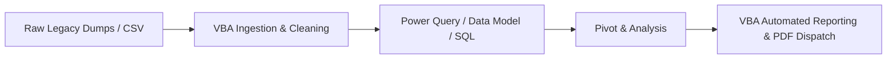

# 📊 VBA for Data Analysts & BI Engineers

> [!important]
> **Core Premise**: Modern Data Analysts do not use VBA to build heavy database engines or machine learning algorithms. Instead, VBA serves as the **tactical edge orchestrator**: automating local data preparation, file ingestion, formatting, email distribution, and bridging corporate legacy spreadsheets into modern BI pipelines.

---

## 🔄 The Analyst Automation Pipeline

---

## 🎯 High-Value VBA Use Cases in Analytics
1. **Unattended File Batch Ingestion**: Consolidating 40 regional store spreadsheets into a single flat staging table before feeding into Power BI.
2. **Automating Repetitive Stakeholder Reports**: Slicing a master dataset by department, creating separate workbooks, and emailing them to 25 cost-center managers every Monday morning.
3. **Triggering Refreshes**: Executing automated `Workbook.RefreshAll` on workbooks connected to SQL Server or web APIs, followed by exporting fresh dashboards to executive PDFs.
4. **Data Validation Gates**: Ensuring uploaded spreadsheets conform to required column headers and data types before ingestion into production warehouses.
