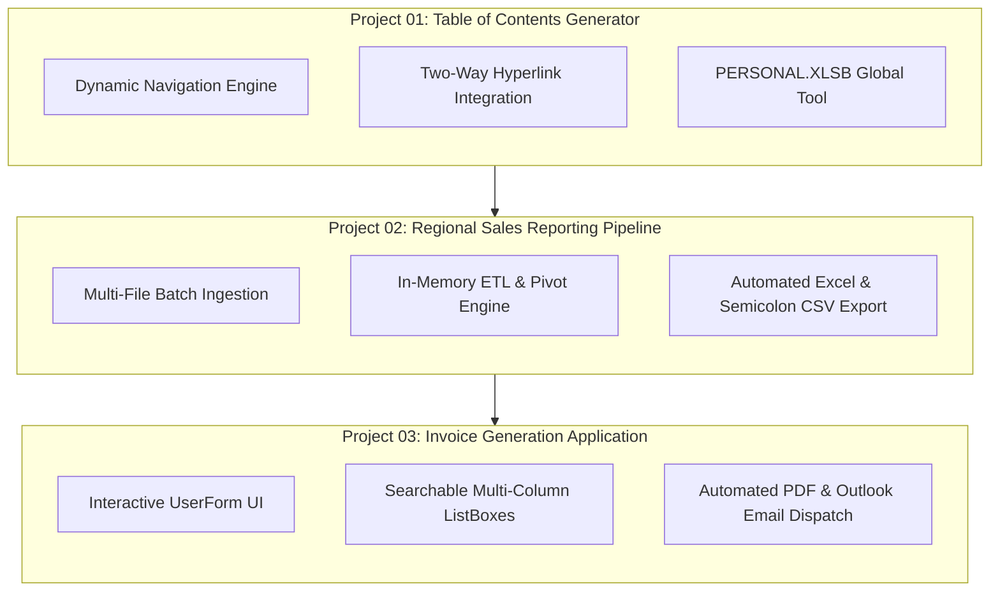

# Automation Projects Portfolio

> [!important]
> **Executive Summary**: This directory documents three milestone automation tools built during the Udemy course *Master Excel VBA and Macros* by Leila Gharani. Each project represents a progressive leap in architectural complexity, moving from workbook navigation to enterprise ETL pipelines and interactive UserForm applications.

---

## 🏗️ Architectural Milestone Progression

---

## 📊 Project Comparison Matrix

| Project | Domain | Primary Technologies | Key Architecture Pattern | Analytics Relevance |
| :--- | :--- | :--- | :--- | :--- |
| **[[Project 01 - Table of Contents Generator]]** | Productivity & Navigation | Worksheets, Range, Hyperlinks, Error Handling | Dynamic Workbook Scanning & Global Utility (`PERSONAL.XLSB`) | Navigating massive corporate workbooks with 50+ tabs |
| **[[Project 02 - Regional Sales Reporting Tool]]** | Reporting & ETL Pipeline | `MultiSelect` FileDialog, PivotTables, File I/O, Arrays | Batch File Aggregation → In-Memory Transform → Pivot & CSV Export | Automated recurring monthly financial/sales reporting |
| **[[Project 03 - Invoice Generation Tool]]** | Interactive Business Application | UserForms, ActiveX, Multi-Column ListBox, Outlook, PDF | Event-Driven CRUD UI → Template Population → Multi-Channel Dispatch | Operational billing, automated document generation, and CRM sync |

---

## 📂 Project Deep Dives
1. **[[Project 01 - Table of Contents Generator/Requirements|Project 01 - Table of Contents Generator]]**
2. **[[Project 02 - Regional Sales Reporting Tool/Requirements|Project 02 - Regional Sales Reporting Tool]]**
3. **[[Project 03 - Invoice Generation Tool/Requirements|Project 03 - Invoice Generation Tool]]**
