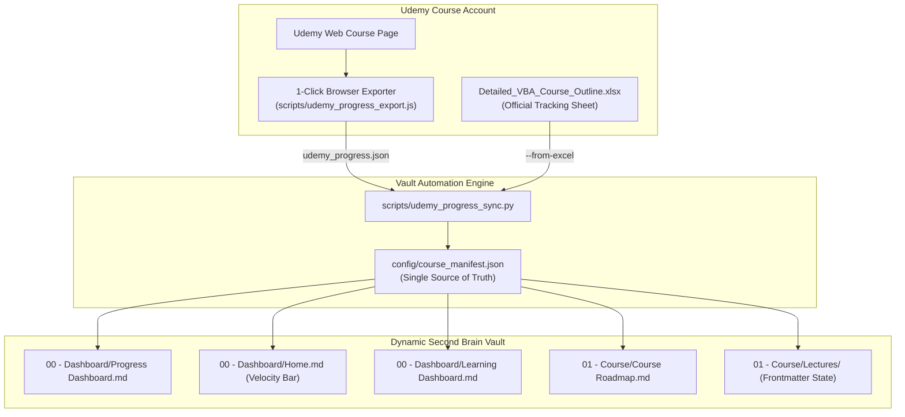

# 🔄 Udemy Course Progress Sync Guide

> [!important]
> **Connecting Obsidian Second Brain to Udemy Progress**  
> This guide outlines how your course completion progress, lecture checkmarks, and study notes are synchronized from Udemy into this vault automatically without manually hardcoding markdown files.

---

## 🌐 The Reality of Udemy's API for Individual Students

Udemy's official public API ([Udemy API Reference](https://www.udemy.com/developers/)) is exclusively provisioned for **Udemy Business enterprise accounts** and approved instructors. Udemy **does not** provide individual consumer students with personal OAuth keys to programmatically mark lectures complete or query personal view history via an open third-party REST endpoint.

To provide a seamless, non-hardcoded workflow, this repository implements a **hybrid 3-tier synchronization system**:



---

## 🚀 The 3 Synchronization Methods

### Method 1: The Automated Excel Outline Sync *(Recommended)*
Leila Gharani provides `Detailed_VBA_Course_Outline.xlsx` alongside the course files. Whenever you mark checkboxes or write notes in this sheet:
1. Open terminal in the repository root.
2. Run:
   ```bash
   python scripts/udemy_progress_sync.py
   ```
3. The script:
   - Reads all 197 rows from `Detailed_VBA_Course_Outline.xlsx`.
   - Extracts your notes and completion flags.
   - Updates `config/course_manifest.json`.
   - Updates the YAML frontmatter of affected lectures (`status: completed`).
   - Automatically recalculates completion percentages and updates all dashboard files.

---

### Method 2: The 1-Click Browser Console Exporter
If you prefer exporting your live completed checkmarks directly from the Udemy web interface:
1. Open your course on Udemy in Google Chrome, Edge, or Brave:
   `https://www.udemy.com/course/excel-vba-and-macros-course/learn/lecture/...`
2. Open Developer Tools (Press **`F12`** or **`Ctrl + Shift + I`**) and click the **Console** tab.
3. Open [`scripts/udemy_progress_export.js`](file:///d:/courses/Data%20Science/Data%20Engineering/Udemy%20Courses/VBA%20&%20Marcos%20Course/Excel-VBA-Second-Brain/scripts/udemy_progress_export.js), copy the entire script, paste it into the Console, and press **Enter**.
4. A file named `udemy_progress.json` will instantly download to your machine.
5. Move `udemy_progress.json` into the vault root and run:
   ```bash
   python scripts/udemy_progress_sync.py --from-json udemy_progress.json
   ```

---

### Method 3: Direct CLI Single-Lecture / Section Commands
To mark lectures or sections completed directly from the terminal without touching any markdown files:

```bash
# Mark a single lecture as complete
python scripts/udemy_progress_sync.py --complete S05-01

# Mark an entire section as complete
python scripts/udemy_progress_sync.py --section 5
```

---

## 🛠️ GitHub Actions Continuous Integration (CI)
When you push to GitHub, `.github/workflows/vault-ci.yml` automatically validates the vault integrity:
- Verifies that `config/course_manifest.json` matches all lecture counts.
- Verifies that all 2,500+ internal wikilinks resolve cleanly without broken links.
- Ensures all markdown notes maintain valid YAML frontmatter.

---

## 🔗 Related Resources
- [[Course Materials & Workbooks Guide]]
- [[VBA Q&A and Debugging Strategy]]
- [[Progress Dashboard]]
- [[Course Roadmap]]
