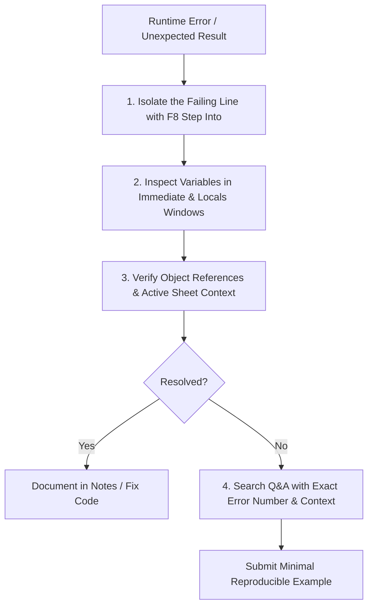

# 🛠️ VBA Q&A and Debugging Strategy

> [!important]
> **Source Material**: Synthesized from `How_to_Ask_Questions.pdf` and Section 08 (*Debugging, Error Handling & Procedure Scope*).  
> **Purpose**: A disciplined protocol for isolating VBA bugs, avoiding duplicate questions, and communicating technical issues effectively.

---

## 🧭 The 4-Step Debugging Protocol Before Asking

When a macro fails or yields unexpected output, execute this troubleshooting sequence before reaching out for help or searching online:

### 1. Identify the Exact Point of Failure
- Do **not** use `On Error Resume Next` while diagnosing. Comment it out so the VBE halts on the specific line causing the error.
- Press **F8** (`Debug -> Step Into`) to walk through the procedure line by line.
- Hover over variables or query them in the **Immediate Window** (`?VariableName`).

### 2. Check the "Unqualified Reference" Trap
- Did you write `Range("A1")` instead of `ws.Range("A1")`?
- An unqualified `Range` or `Cells` call implicitly defaults to `ActiveSheet`. If the wrong worksheet or workbook is active, runtime errors or corrupted data will occur.

### 3. Check Data Types & Variable Scope
- Did a row count exceed 32,767 while typed as `Integer`? (Always use `Long`).
- Did you declare a variable inside a procedure when it needed module-level scope?
- Is `Option Explicit` placed at the very top of every module?

### 4. Search Existing Q&A Knowledge First
- Before posting, search the course Q&A board using:
  - Exact runtime error number (e.g., `Run-time error '1004'`, `Run-time error '9': Subscript out of range`).
  - Key method name (e.g., `Range.End(xlUp)`, `Workbooks.Open`, `FreeFile`).
  - Lecture reference (e.g., `Section 04 Lecture 04`).

---

## 📝 Submitting a High-Quality Technical Question

If the issue persists, provide a structured question report containing:

1. **Course Context**: Section and lecture number (e.g., *Section 12, Lecture S12-05*).
2. **Exact Error Message**: Full title and description (e.g., `Run-time error '91': Object variable or With block variable not set`).
3. **Exact Failing Line**: The specific line highlighted in yellow when clicking **Debug**.
4. **Minimal Reproducible Code**: Only the relevant subroutine, cleanly formatted and commented.
5. **Workbook State**: Relevant sheet names, active selections, and data layout.
6. **Expected vs Actual Behavior**: What was supposed to happen vs what actually occurred.

---

## 🔗 Related Vault Resources
- [[Debugging]]
- [[Error Handling]]
- [[Immediate Window]]
- [[Watch Window]]
- [[Locals Window]]
- [[Course Materials & Workbooks Guide]]
