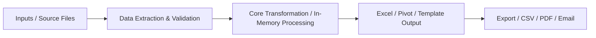

# {{title}}

> [!important]
> **Executive Summary**: High-level problem statement and the automation solution built.

---

## 🏢 Business Problem & Objective
- **Problem**: 
- **Pain Points**: Manual repetition, human error, time expenditure.
- **Solution Goal**: 

---

## 🏗️ Architecture & Pipeline Flow

---

## 📦 Inputs, Outputs & Dependencies
| Component | Type | Description |
| :--- | :--- | :--- |
| **Input** | Range / Files | |
| **Output** | Worksheet / File | |
| **Dependencies** | Library / Workbook | |

---

## 🔑 Core VBA Concepts & Objects Used
- [[Workbooks]], [[Worksheets]], [[Range]]
- [[Error Handling]]
- [[Performance Optimization]]

---

## 🛡️ Reliability & Error Handling Strategy
- ScreenUpdating and DisplayAlerts management
- Validation checks before destructive operations
- Clean exit handlers ensuring Excel state restoration

---

## 💡 Lessons Learned & Key Takeaways
- 

---

## 🚀 Future Improvements & Extensions
- [ ] Centralized configuration worksheet
- [ ] Automated logging
- [ ] Python / Power BI integration
