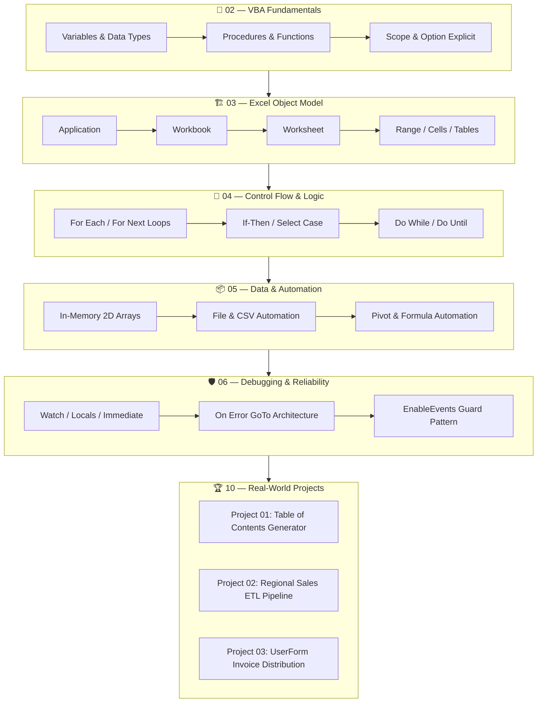
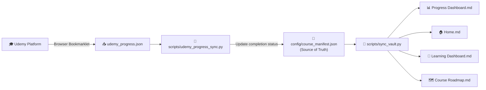

# 🧠 Excel VBA Second Brain

> **From Repetitive Excel Tasks → Automated, Production-Ready Systems.**
>
> A personal knowledge system for mastering Excel VBA, Macros, Automation Architecture, Debugging, UserForms, and Office Suite Integration.

[](https://obsidian.md)
[](https://learn.microsoft.com/en-us/office/vba/api/overview/)
[](https://microsoft.com/excel)
[](https://python.org)
[](LICENSE)
[](https://github.com/Sohila-Khaled-Abbas/Excel-VBA-Second-Brain/actions)

---

## 🗺️ Quick Navigation

| Section | Link |
| :--- | :--- |
| 🧭 Learning Philosophy | [Overview & Design Principles](#-overview--learning-philosophy) |
| 📁 Repository Structure | [Folder Architecture](#-repository-architecture) |
| 📚 Curriculum Map | [21 Sections · 174 Lectures](#-course-curriculum-map) |
| ⚡ Dynamic Engine | [Non-Hardcoded Sync System](#-dynamic-engine--non-hardcoded-architecture) |
| 🎓 Udemy Progress | [Connecting Your Progress](#-udemy-progress-tracking) |
| 🛠️ Obsidian Setup | [Recommended Plugins](#-recommended-obsidian-setup) |
| 🤝 Contributing | [CONTRIBUTING.md](CONTRIBUTING.md) |
| 🔒 Security | [SECURITY.md](SECURITY.md) |

---

## 🧭 Overview & Learning Philosophy

This repository is **not** a lecture transcript dump. It is an interconnected **Second Brain** built on permanent, evergreen knowledge connecting VBA concepts across lectures, real-world reporting pipelines, and production business projects.



### Core Design Principles

| Principle | Description |
| :--- | :--- |
| **Concept-Centric** | Permanent notes that outlive the course, wikilinked across all domains |
| **Data Engineering Perspective** | Built for BI and analytics workflows: VBA + Power Query + Python |
| **Engineering-Grade Reliability** | Defensive programming, `On Error GoTo`, speed optimization, bulletproof debugging |

---

## 📁 Repository Architecture

```text
Excel-VBA-Second-Brain/
│
├── .github/                      # GitHub automation & community health
│   ├── ISSUE_TEMPLATE/           # Bug report, course question, snippet request
│   ├── workflows/
│   │   ├── vault-ci.yml          # Auto-validates wikilinks on every push/PR
│   │   └── sync-progress.yml     # Manual workflow: regenerate dashboards
│   └── pull_request_template.md
│
├── config/                       # 🔑 Non-hardcoded dynamic engine configs
│   ├── course_manifest.json      # Source of truth: 21 sections, 174 lectures, status
│   └── vault_config.json         # Vault root, author, metadata
│
├── scripts/                      # 🤖 Python automation scripts
│   ├── sync_vault.py             # Regenerate all dashboards from course_manifest.json
│   ├── validate_vault.py         # Wikilink & frontmatter linter (CI-ready)
│   ├── udemy_progress_sync.py    # CLI: mark lectures/sections complete
│   └── udemy_progress_export.js  # Browser bookmarklet: export live Udemy progress
│
├── 00 - Dashboard/               # 📊 Central command centers (Home, Progress, Roadmap)
├── 01 - Course/                  # 📚 21 section hubs + 174 lecture notes
├── 02 - VBA Fundamentals/        # Core syntax, variables, scope, procedures
├── 03 - Excel Object Model/      # Application, Workbook, Worksheet, Range, Tables
├── 04 - Control Flow & Logic/    # Loops, conditionals, iteration patterns
├── 05 - Data & Automation/       # Arrays, collections, files, CSV, performance
├── 06 - Debugging & Reliability/ # Watch, Locals, Immediate, Error Handling
├── 07 - Events & User Interfaces/# Events, UserForms, ActiveX controls
├── 08 - Advanced VBA/            # Architecture, Power Query bridge, COM binding
├── 09 - Office Automation/       # Outlook, Word, PowerPoint, PDF export
│
├── 10 - Projects/                # 🏆 Three complete real-world projects
│   ├── Project 01 - Table of Contents Generator/
│   ├── Project 02 - Regional Sales Reporting Tool/
│   └── Project 03 - Invoice Generation Tool/
│
├── 11 - Labs & Experiments/      # Benchmarks, failed attempts, sandboxes
├── 12 - Code Cookbook/           # Production-ready VBA patterns & snippets
├── 13 - Cheat Sheets/            # Quick-reference syntax and object sheets
├── 14 - Questions & Insights/    # Interview prep & active recall question bank
├── 15 - MOCs/                    # Maps of Content (visual knowledge hubs)
├── 16 - Resources/               # Authoritative references & Udemy sync guide
├── 99 - Templates/               # Standardized note templates
│
├── _private/                     # 🔒 Git-ignored: course binaries (local only)
├── README.md                     # This file
├── CONTRIBUTING.md               # How to contribute
├── CHANGELOG.md                  # Version history (Keep a Changelog format)
├── CODE_OF_CONDUCT.md            # Contributor Covenant v2.1
├── SECURITY.md                   # VBA macro security policy
└── LICENSE                       # MIT License
```

---

## 📚 Course Curriculum Map

**21 Sections · 174 Lectures · 22.5 Hours of Training**

### 📘 Sections 01–07 — Foundations & Core VBA

| # | Section Title | Lectures | Status | Key Topics |
| :-: | :--- | :-: | :-: | :--- |
| **01** | Welcome to the Course | 4 | ✅ | Setup, project files, course expectations |
| **02** | Your First Macro | 10 | ✅ | Macro Recorder, VBE, Buttons, Absolute vs Relative |
| **03** | The Object Model | 9 | ✅ | Application, Workbooks, Sheets, Ranges, Properties & Methods |
| **04** | Referencing Ranges, Worksheets & Workbooks | 10 | 🟡 | 4 Last-Row Methods, Cells vs Range, Variable Ranges |
| **05** | Working with Variables | 8 | ⚪ | Dim, Data Types, Option Explicit, Set Statement, Scope |
| **06** | Looping & Making Decisions | 10 | ⚪ | For Each, With…End With, If-Then-Else, Select Case |
| **07** | Useful Built-in Functions | 8 | ⚪ | MsgBox, InputBox, Application.InputBox (Range Selection) |

### 🏆 Sections 08–09 — Debugging & Milestone Project 1

| # | Section Title | Lectures | Status | Key Topics |
| :-: | :--- | :-: | :-: | :--- |
| **08** | Debugging, Error Handling & Scope | 9 | ⚪ | Watch, Locals, Immediate Window, On Error GoTo, ByVal/ByRef |
| **09** | **Main Project #1: Table of Contents Tool** | 7 | ⚪ | Dynamic TOC, Hyperlinks, Personal Macro Workbook |

### 📦 Sections 10–13 — Intermediate Automation

| # | Section Title | Lectures | Status | Key Topics |
| :-: | :--- | :-: | :-: | :--- |
| **10** | Looping in VBA (Controlling Flow) | 12 | ⚪ | For Next, Reverse Loops, Do While/Until, Find Method |
| **11** | Working with Arrays | 9 | ⚪ | 1D & 2D Arrays, ReDim Preserve, Variant Array Memory Speed |
| **12** | Working with Files, Folders & Text Files | 9 | ⚪ | Dir(), GetOpenFilename, FileDialog, CSV Export, FreeFile |
| **13** | Excel Tables, Formulas & Pivot Tables | 7 | ⚪ | ListObjects, FormulaR1C1, PivotTables, IFERROR Injection |

### 🏆 Section 14 — Milestone Project 2: Regional Reporting ETL

| # | Section Title | Lectures | Status | Key Topics |
| :-: | :--- | :-: | :-: | :--- |
| **14** | **Main Project #2: Regional Reporting Tool** | 11 | ⚪ | Multi-File Consolidation, Template Generation, Semicolon CSV |

### 🎛️ Sections 15–18 — Advanced Automation & UserForms

| # | Section Title | Lectures | Status | Key Topics |
| :-: | :--- | :-: | :-: | :--- |
| **15** | Interacting with Other Applications | 6 | ⚪ | PDF Generation, Outlook Mail Automation, Word & PPT Export |
| **16** | Worksheet & Workbook Events | 8 | ⚪ | SheetChange, SelectionChange, Intersect, Auto-Refresh Pivots |
| **17** | UserForms & ActiveX Controls | 11 | ⚪ | ComboBox, ListBox, CheckBox, MultiPage, Data Entry Forms |
| **18** | **Main Project #3: Invoice Generation Tool** | 11 | ⚪ | Multi-Column Searchable ListBox, Master Data, PDF & Email |

### 🚀 Sections 19–21 — Expert VBA & Wrap-Up

| # | Section Title | Lectures | Status | Key Topics |
| :-: | :--- | :-: | :-: | :--- |
| **19** | Creating Customized Functions (UDFs) | 8 | ⚪ | Function Procedures, Optional Arguments, Age Calc, SumByColor |
| **20** | Working with Charts | 5 | ⚪ | ChartObjects, Formatting, Animation, UserForm Charts |
| **21** | Summary & Final Words | 2 | ⚪ | Next Steps & Long-Term Mastery Path |

> **Status Key**: ✅ Completed · 🟡 In Progress · ⚪ Planned

---

## ⚡ Dynamic Engine — Non-Hardcoded Architecture

This vault uses a **config-driven sync system** so that progress, dashboards, and statistics are never manually hardcoded into Markdown files.



### Usage Commands

```bash
# Regenerate all dashboard Markdown files
python scripts/sync_vault.py

# Validate all wikilinks and frontmatter (CI-safe, exits 0 on pass)
python scripts/validate_vault.py

# Mark a single lecture as complete
python scripts/udemy_progress_sync.py --complete S04-03

# Mark all lectures in a section as complete
python scripts/udemy_progress_sync.py --section 3

# Sync from a Udemy progress JSON export
python scripts/udemy_progress_sync.py --from-json udemy_progress.json
```

---

## 🎓 Udemy Progress Tracking

> **Note**: Udemy's public API does not expose write access for individual student accounts. The system below bridges Udemy and this vault with zero API tokens required.

### 3-Layer Sync Architecture

| Layer | Method | Tool | When to Use |
| :--- | :--- | :--- | :--- |
| **1 — Browser Export** | JS Console Bookmarklet | `scripts/udemy_progress_export.js` | Paste in browser DevTools on your Udemy course page |
| **2 — CLI Sync** | Python CLI | `scripts/udemy_progress_sync.py` | After watching each lecture or completing a section |
| **3 — Excel Outline** | Parse spreadsheet | `--from-excel` flag | If you track progress in a separate Excel tracker |

See [`16 - Resources/Udemy Progress Sync Guide.md`](16%20-%20Resources/Udemy%20Progress%20Sync%20Guide.md) for full setup instructions.

---

## 🛠️ Recommended Obsidian Setup

This vault is **100% readable in standard Markdown** on GitHub. Opening in [Obsidian](https://obsidian.md) unlocks the interactive graph, wikilink navigation, and dynamic Dataview tables.

### Recommended Community Plugins

| Plugin | Purpose |
| :--- | :--- |
| **Dataview** | Dynamic tables for lecture progress, snippet search, and open questions |
| **Templater** | Automates note creation from `99 - Templates/` standardized templates |
| **Tasks** | Manages checkboxes and review schedules across notes |
| **Omnisearch** | High-speed fuzzy search across code snippets and documentation |
| **Admonition** | Styled callouts: `[!tip]`, `[!warning]`, `[!important]` |

### Theme & Styling

- **Theme**: `Minimal` (by kepano)
- **CSS Snippet**: `second-brain.css` in `.obsidian/snippets/` — Excel forest green palette (`#107C41`)
- **Typography**: `Inter` for prose · `Source Code Pro` for VBA code blocks

---

## 🤝 Contributing

Contributions that add technical depth, production patterns, or improved wikilink connections are welcome!

See **[CONTRIBUTING.md](CONTRIBUTING.md)** for note frontmatter standards, VBA code style rules, and PR checklist.

See **[CODE_OF_CONDUCT.md](CODE_OF_CONDUCT.md)** for community standards.

---

## 🔒 Copyright, Privacy & Attribution

- **Original Work**: All conceptual explanations, architectural diagrams, mental models, code snippets, and synthesis represent the author's personal study notes and original code.
- **Course Reference**: This second brain was developed while studying:
  > *Master Excel VBA and Macros from Basics to Advanced with Three Complete Real-World Automation Projects* — by **Leila Gharani** on Udemy
- **No Copyrighted Content**: This repository does **not** host Udemy video files, official slides, proprietary workbooks, or verbatim transcriptions. All binary practice files are in the local, git-ignored `_private/` directory.

---

## 📄 License

This repository is open-sourced under the [MIT License](LICENSE).

---

*Built with 🧠 Obsidian · 🟢 VBA · 🐍 Python · ⚙️ GitHub Actions*
