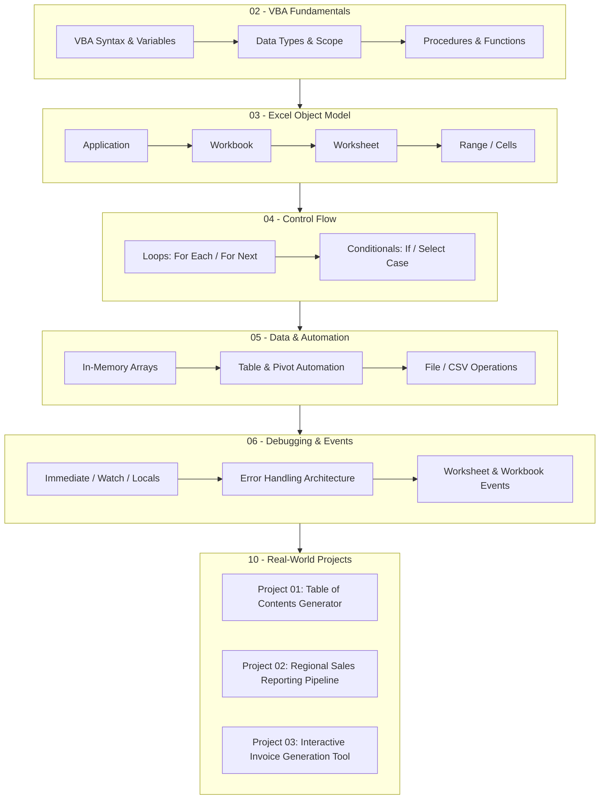

# Excel VBA Second Brain

> **From Repetitive Excel Tasks → Automated, Production-Ready Systems.**  
> A personal knowledge system for learning, mastering, and documenting Excel VBA, macros, automation architecture, debugging, UserForms, and Office integration.

[](https://obsidian.md)
[](https://learn.microsoft.com/en-us/office/vba/api/overview/)
[](https://microsoft.com/excel)
[](LICENSE)

---

## 🧭 Overview & Learning Philosophy

This repository is **NOT** a simple dump of lecture slides or a duplicate of video transcripts. Instead, it is an interconnected **Second Brain** built around permanent knowledge:
- **Concept-Centric**: Concepts exist as permanent, evergreen notes that connect across lectures, real-world reporting pipelines, and business projects.
- **Data Analytics & BI Integration**: Designed specifically from the perspective of modern Data Analysis, ETL pipelines, and reporting automation (connecting Excel VBA with Power Query, Power Pivot, SQL, and Python).
- **Engineering-Grade Reliability**: Deep emphasis on defensive programming, error handling (`On Error GoTo`), performance optimization (`ScreenUpdating`, `Calculation`, `Memory Arrays`), and bulletproof debugging.



---

## 🗂️ What This Repository Contains

1. **`00 - Dashboard/`**: Central command centers including [[Home]], [[Learning Dashboard]], [[Knowledge Map]], [[Project Dashboard]], and [[Progress Dashboard]].
2. **`01 - Course/`**: The structured learning map based on Leila Gharani's comprehensive Udemy course (*Master Excel VBA and Macros*), covering 21 sections, 174 lectures, and 22.5 hours of training.
3. **`02 - 09 Concept Layers`**: Evergreen notes covering VBA Fundamentals, Excel Object Model, Logic, In-Memory Arrays, Debugging, Events, UserForms, and Office Suite Automation.
4. **`10 - Projects/`**: In-depth architectural documentation for three complete, production-style projects:
   - **Project 01**: Automated Dynamic Table of Contents Generator
   - **Project 02**: Regional Sales Reporting Tool (ETL & Multi-File Consolidation Pipeline)
   - **Project 03**: UserForm-Driven Invoice Generation & Outlook Distribution Tool
5. **`11 - Labs & Experiments/`**: Sandboxes, test scripts, and documented failed attempts with root-cause analysis.
6. **`12 - Code Cookbook/`**: Categorized, copy-pasteable, production-ready VBA patterns (file dialogs, array processing, pivot refresh, email dispatch).
7. **`13 - Cheat Sheets/`**: Quick-reference guides for syntax, object hierarchy, debugging hotkeys, and loops.
8. **`14 - Questions & Insights/`**: Active recall questions, conceptual breakthroughs, and interview preparation.
9. **`15 - MOCs/`**: Maps of Content serving as visual navigation hubs for the knowledge graph.
10. **`99 - Templates/`**: Standardized templates for lectures, concepts, projects, learning sessions, and experiments.

---

## 🗺️ Learning Roadmap & Course Outline

The knowledge base tracks the full journey across **21 sections** and **174 lectures**:

| Section | Title | Lectures | Status | Key Topics |
| :---: | :--- | :---: | :---: | :--- |
| **01** | Welcome to the course | 4 | ✅ Completed | Setup, Course Expectations, Project Files |
| **02** | Your First Macro | 10 | ✅ Completed | Macro Recorder, VBE, Buttons, Absolute vs Relative |
| **03** | The Object Model | 9 | ✅ Completed | Application, Workbooks, Sheets, Ranges, Properties & Methods |
| **04** | Referencing Ranges, Worksheets & Workbooks | 10 | 🟡 In Progress | 4 Last-Row Methods, Cells vs Range, Variable Ranges |
| **05** | Working with Variables | 8 | ⚪ Planned | Dim, Data Types, Option Explicit, Set Statement, Scope |
| **06** | Looping through Collections & Making Decisions | 10 | ⚪ Planned | For Each, With...End With, If-Then-Else, Select Case |
| **07** | Useful Built-in Functions | 8 | ⚪ Planned | MsgBox, InputBox, Application.InputBox (Range Selection) |
| **08** | Debugging, Error Handling & Procedure Scope | 9 | ⚪ Planned | Watch, Locals, Immediate Window, On Error GoTo, ByVal/ByRef |
| **09** | **Main Project #1: Table of Contents Tool** | 7 | ⚪ Planned | Dynamic TOC, Hyperlinks, Personal Macro Workbook (PERSONAL.XLSB) |
| **10** | Looping in VBA (Controlling Flow) | 12 | ⚪ Planned | For Next, Reverse Loops, Do While, Do Until, Find Method |
| **11** | Working with Arrays | 9 | ⚪ Planned | 1D & 2D Arrays, ReDim Preserve, Variant Array Memory Speed |
| **12** | Working with Files, Folders & Text Files | 9 | ⚪ Planned | Dir(), GetOpenFilename, FileDialog, CSV Export, FreeFile |
| **13** | Excel Tables, Formulas & Pivot Tables | 7 | ⚪ Planned | ListObjects, FormulaR1C1, PivotTables, IFERROR Injection |
| **14** | **Main Project #2: Regional Reporting Tool** | 11 | ⚪ Planned | Multi-File Consolidation, Template Generation, Semicolon CSV |
| **15** | Interacting with Other Applications | 6 | ⚪ Planned | PDF Generation, Outlook Mail Automation, Word & PPT Export |
| **16** | Worksheet & Workbook Events | 8 | ⚪ Planned | SheetChange, SelectionChange, Intersect, Auto-Refresh Pivots |
| **17** | UserForms & ActiveX Controls | 11 | ⚪ Planned | ComboBox, ListBox, CheckBox, MultiPage, Data Entry Forms |
| **18** | **Main Project #3: Invoice Generation Tool** | 11 | ⚪ Planned | Multi-Column Searchable ListBox, Master Data, PDF & Email |
| **19** | Creating Customized Functions (UDFs) | 8 | ⚪ Planned | Function Procedures, Optional Arguments, Age Calc, SumByColor |
| **20** | Working with Charts | 5 | ⚪ Planned | ChartObjects, Chart Formatting, Animation, UserForm Charts |
| **21** | Summary & Final Words | 2 | ⚪ Planned | Next Steps & Long-Term Mastery |

---

## 🏗️ Repository Architecture

```text
Excel-VBA-Second-Brain/
├── .obsidian/               # Vault configuration, Minimal theme, CSS snippets
├── _private/                # Git-ignored staging for personal/course binaries
├── assets/                  # Diagrams, images, and documentation assets
├── 00 - Dashboard/          # Central entry points & progress tracking
├── 01 - Course/             # Learning roadmap, section hubs, and 174 lecture notes
├── 02 - VBA Fundamentals/   # Core syntax, variables, scope, and procedures
├── 03 - Excel Object Model/ # Application, Workbook, Worksheet, Range, Tables
├── 04 - Control Flow/       # Conditionals and looping constructs
├── 05 - Data & Automation/  # Arrays, collections, files, CSV, and performance
├── 06 - Debugging/          # Watch, Locals, Immediate, and Error Handling Matrix
├── 07 - Events & UI/        # Events, UserForms, and ActiveX controls
├── 08 - Advanced VBA/       # Architecture, Best Practices, VBA for Data Analysts
├── 09 - Office Automation/  # Outlook, Word, PowerPoint, and PDF export
├── 10 - Projects/           # Dedicated folders for Projects 01, 02, and 03
├── 11 - Labs & Experiments/ # Playgrounds and sandbox tests
├── 12 - Code Cookbook/      # Production-ready VBA snippets and patterns
├── 13 - Cheat Sheets/       # Quick-reference syntax and object sheets
├── 14 - Questions & Insights# Active recall and interview preparation
├── 15 - MOCs/               # Maps of Content (VBA, Excel, Data, Reporting, Office)
├── 16 - Resources/          # Authoritative documentation links and references
└── 99 - Templates/          # Standardized templates for notes, projects, sessions
```

---

## 💻 Recommended Obsidian Setup

This vault is designed to be **100% functional and readable in standard Markdown** on GitHub and basic Markdown editors. However, opening it in [Obsidian](https://obsidian.md) unlocks enhanced interactive features:

### Recommended Community Plugins
- **Dataview**: Generates dynamic tables for lecture progress, snippet search, and open questions.
- **Tasks**: Manages checkboxes and review schedules across notes.
- **Templater**: Automates note creation using the standardized templates in `99 - Templates/`.
- **Omnisearch**: High-speed fuzzy search across code snippets and documentation.
- **Admonition**: Provides styled callouts (`[!tip]`, `[!warning]`, `[!important]`).
- **Table Editor**: Enhanced Markdown table editing.

### Theme & Styling
- **Theme**: `Minimal` (by kepano)
- **CSS Snippets**: `second-brain.css` (included in `.obsidian/snippets/`), providing a tailored Microsoft Excel forest green aesthetic (`#107C41`), custom status badges, and polished Dataview tables.
- **Typography**: `Inter` for interface and prose; `Source Code Pro` for VBA code blocks.

---

## 🔒 Copyright, Privacy & Attribution

- **Original Work**: All conceptual explanations, architectural diagrams, mental models, code snippets, and synthesis in this repository represent the author's personal study notes and original code.
- **Course Reference**: This second brain was developed while studying the Udemy course:
  *Master Excel VBA and Macros from Basics to Advanced with Three Complete Real-World Automation Projects* by **Leila Gharani**.
- **No Course Assets Included**: In accordance with intellectual property laws and ethical standards, this public repository does **NOT** host or distribute copyrighted Udemy video files, official course slides, proprietary practice workbooks, or verbatim transcriptions. All binary practice files remain strictly sequestered in the local, git-ignored `_private/` directory.

---

## 📄 License
This repository is open-sourced under the [MIT License](LICENSE).
